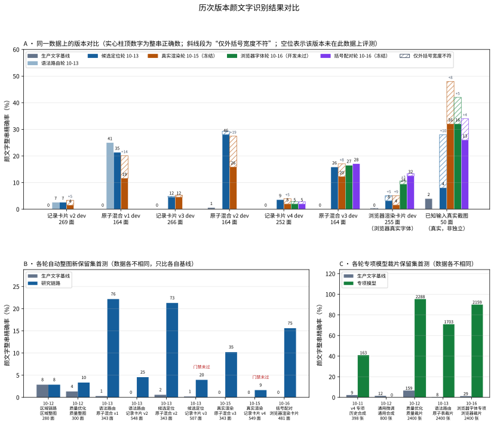

# LocalOCR

LocalOCR 提供本机 OCR 推理服务、Windows x64 CPU 独立运行时，以及合成数据生成、模型训练和评测工具。仓库维护 OCR 结果结构、离线模型包和模型管理接口；应用界面、命名管道、结果预览及安装器由应用工程维护。

当前软件版本为 **0.1.0-rc.2**，属于候选交付。文字基线的服务接口、模型管理和独立运行时已有本机验证记录；识别质量按具体模型、数据集和评测链路分别报告。研究模型未满足接入条件，未替换当前文字基线。

## 当前状态

| 项目 | 状态 | 验证范围 |
| --- | --- | --- |
| CPU 推理与 HTTP 服务 | 已完成本机验证 | 固定本地模型、JSON 区域结果、认证及请求生命周期 |
| 离线模型管理 | 已完成本机验证 | 手动导入、完整性校验、CPU 探针、启用和回退 |
| Windows x64 独立运行时 | 已完成本机验证 | 双 EXE 冻结、解压运行、源码包重建和进程审计 |
| 颜文字识别研究（专项模型、两阶段链路） | 未满足接入条件，研究链路未接入生产 | 当前研究版本（2026-10-15）在已知输入真实截图开发探针上整串 16/50（基线 2/50，非独立），合成新保留集原子混合 35/343 通过门禁、记录卡片 9/549 未过；浏览器真实字体渲染开发集只有 4/255（上一版本 8/255，基线 0/255），正文保护未过。各版本优劣见[历次版本对比](#历次版本对比) |
| 应用集成、安装器与跨机器运行 | 尚未验收 | 需由应用工程分别验证 |

推理仅使用本机 CPU；HTTP 服务绑定 `127.0.0.1`。推理和模型导入期间不上传图片、不调用云端、不下载模型，也不抓取远程图片 URL。模型须在启动前由用户合法取得并安装。

- [版本与身份](#版本与身份)
- [工程范围与接口](#工程范围与接口)
- [本机服务](#本机服务)
- [Windows x64 独立运行时](#windows-x64-独立运行时)
- [工程验证](#工程验证)
- [评测结果](#评测结果)（含[历次版本对比](#历次版本对比)与[各轮研究记录](#各轮研究记录)）
- [数据、许可与工具](#数据许可与工具)

## 版本与身份

| 对象 | 标识 | 用途 |
| --- | --- | --- |
| 软件 | `0.1.0-rc.2` | LocalOCR 候选软件交付 |
| 文字基线模型包 | `text-ppocrv6-1.0.0` | 模型包身份；权重与既有基线一致 |
| 接口与数据结构 | `/v1`、`localocr.result.v1`、`localocr.bundle.v1` | 协议兼容边界 |
| 颜文字专项候选 | `ppocrv6-tiny-exp-20261013-001` | 研究链路当前使用的冻结专项模型；`promote=false`、`enabled=false` |
| 历史实验候选 | `kaomoji-exp-20261011-004` | 历史实验标记 v4；已拒绝接入 |

软件、模型、协议及实验编号独立维护。软件版本与交付名称由 `localocr/version.py` 生成；规范见 [版本命名契约](docs/contracts/versioning.md)。

## 工程范围与接口

- **推理**：本机 CPU、固定本地模型、有限的符号区域二次识别、原图区域坐标，以及未经 Unicode 归一化的区域文本和分数。识别分数未经概率校准。
- **训练与评测**：合成训练、开发集选择、冻结模型后评测保留集；私人截图仅用于本地验证。训练工具提供 CUDA/MPS/CPU 设备选择和 ONNX 导出；CUDA 已在本机实测，MPS 尚未实机验收。设备选择能力不改变服务的 CPU 推理边界。
- **HTTP 服务**：仅监听 `127.0.0.1`，提供 `GET /v1/models` 和非流式 `POST /v1/chat/completions`。
- **模型管理**：本地 CLI 手动导入、校验、CPU 探针、启用与回退；不提供 HTTP 管理端点。

客户端须支持自定义本机 Base URL、Bearer 令牌、单张 Base64 PNG/JPEG 和非流式 Chat Completions，并解析 `assistant.content` 内的 OCR JSON。`system` 消息、聊天历史、工具调用、远程图片 URL 与未支持参数均被拒绝。已记录 OpenAI Python SDK 3.28.0 的真实 CPU 调用验证；其他客户端应按 [API v1 契约](docs/contracts/api-v1.md) 检查接入条件。

### 架构与运行边界


[离线交互架构图](docs/diagrams/localocr.html)支持缩放、搜索、源码引用和明暗主题；[可编辑 Archify JSON](docs/diagrams/localocr.architecture.json)保留图源，[图表验收记录](docs/diagrams/localocr.architecture.acceptance.md)说明验证范围。

图中关系表示请求、子进程监督及模型读取；客户端与 HTTP 服务之间的箭头合并表示请求及响应。HTTP 服务先回收图片解码子进程，再启动本次请求的 OCR worker；独立运行时 CLI 单独监督 worker，不包含 HTTP 服务。训练与评测工具独立运行，研究产物不自动进入活动模型库。

API 与 OCR worker 分进程运行。worker 在模型校验与依赖导入前安装 Python 进程级审计钩子，拒绝受审计的网络操作及额外进程执行；该机制不构成操作系统级沙箱。服务实施图片和输出预算、超时、取消及请求所属临时文件清理。推理期间无上传、云端回退、模型下载或远程图片抓取。接口结构见 [API 契约](docs/contracts/api-v1.md)，更新流程见 [模型包契约](docs/contracts/model-bundle-v1.md)。

#### 两阶段链路落实状态

设计阶段确定的目标链路为：原图经通用文字检测与识别后，普通正文直接保留；同时结合原图寻找颜文字候选区域，由专项模型识别裁片，经校验与合并后以 JSON 返回应用预览。截至 2026-10-15，该链路分属两条实现，二者尚未接通。

| 目标环节 | 生产链路（`0.1.0-rc.2`，应用实际调用） | 研究链路（`tools/RegionKaomoji`，未启用） |
| --- | --- | --- |
| 通用文字检测与识别 | `scripts/local-ai-ocr-worker.py` 执行 RapidOCR 检测、方向分类与识别 | 直接导入同一 worker 模块执行；输出与生产 JSON 逐项一致 |
| 保留普通正文 | 全部首遍区域原样输出 | 未被替换的首遍区域以 `source: baseline` 原样输出 |
| 结合原图寻找颜文字候选区域 | 未实现。符号复读候选仅来自首遍检测框，空白区域不产生候选 | `candidates.locate_candidates` 合并原图前景连通域、原图括号形状与首遍符号框三路来源 |
| 专项模型识别裁片 | 未实现。复读使用同一生产识别器 | 路由合格候选按三视图裁片送微调 Tiny 候选模型 |
| 校验并合并结果 | 复读视图投票：至少两视图原始字符串一致且字母数字锚点不变 | `fusion.fuse_candidates`：视图投票、独立像素证据与正文锚点保护；外括号宽度按基线裁决；不确定时保留基线 |
| JSON 返回应用预览 | `localocr.result.v1`，经 HTTP 服务返回 | `localocr.region-research.v1` 研究记录；不经服务，不进入应用 |

生产代码不导入研究模块，研究输出不是应用消费的结果结构，候选模型 `ppocrv6-tiny-exp-20261013-001` 保持 `enabled: false`。研究链路另含识别前首遍框切分、混合框上下文复读与融合前重新定位审计三项设计图未列出的保护步骤。2026-10-13 的本机对照确认两条链路的首遍输出逐项一致、研究链路的文本改动只限于被接受的候选区域，细节见[生产链路与研究链路本机对照](docs/evaluation/chain-comparison-20261013/README.md)。

接通生产前仍需：真实字体下的识别能力（浏览器真实字体渲染开发集当前只有 4/255，WebP 与 100% 缩放几乎全错）、独立的真实截图颜文字验证（当前仅有非独立探针 16/50，今后取自日常使用的截图）、记录卡片与浏览器渲染卡片的正文保护（行尾残片仍会被相邻颜文字吸收）、卡片版式 CPU 耗时进一步压缩（单张 p50 已由 15.6 秒降到约 4.5 秒），以及应用端区域选择、取消与预览生命周期验收。

## 本机服务

已验证的服务环境为 Python 3.11 与固定 CPU 依赖。建议使用独立虚拟环境；依赖安装属于开发准备，推理与模型导入离线执行。以下示例从仓库根目录运行，并将 `<模型目录>` 替换为实际的本地目录。

该目录须包含契约指定的 det、cls、rec 基线文件，文件名、大小和 SHA-256 应符合[模型包契约](docs/contracts/model-bundle-v1.md)。创建命令附带仓库保留的模型许可材料。仓库不包含模型权重；创建模型包命令不负责下载权重。首次创建包时应使用尚不存在的输出目录。

```powershell
py -3.11 -m venv .venv
.venv\Scripts\python.exe -m pip install -r requirements-service.txt
.venv\Scripts\python.exe -m localocr.bundle_cli create-baseline --models "<模型目录>" --output artifacts/text-ppocrv6-1.0.0 --version text-ppocrv6-1.0.0
.venv\Scripts\python.exe -m localocr.bundle_cli install --source artifacts/text-ppocrv6-1.0.0 --store artifacts/model-store
.venv\Scripts\python.exe -m localocr.bundle_cli activate --store artifacts/model-store --version text-ppocrv6-1.0.0
.venv\Scripts\python.exe -m localocr --store artifacts/model-store --port 8765
```

服务首次启动时生成本机访问令牌并保存于 `artifacts/model-store/access-token`；两个 HTTP 端点均要求 Bearer 认证。令牌不应提交或随模型包分发。软件升级不自动改变活动模型；旧模型身份与在途请求版本保留。

客户端请求格式、SDK 示例、资源上限和错误语义见 [API v1 契约](docs/contracts/api-v1.md)。客户端应先查询活动模型身份，再发送单张 Base64 PNG/JPEG；`assistant.content` 为需要解析的 OCR JSON 字符串。

## Windows x64 独立运行时

独立运行包提供 `local-ai-ocr.exe`、`localocr-models.exe`、共享 `_internal`、完整许可证和逐文件库存，整个目录须一起复制。HTTP 服务使用独立 Python 依赖，不随该子进程包部署。CLI、预算和取消约定见 [运行时契约](docs/contracts/runtime-v1.md)。

| 本地产物 | 内容 |
| --- | --- |
| `localocr-runtime-0.1.0-rc.2-windows-x64.zip` | 双 CPU EXE、共享依赖、34 项组件许可、接口契约与库存 |
| `localocr-model-text-ppocrv6-1.0.0.zip` | 原字节文字基线模型包，手动导入及启用 |
| `localocr-source-0.1.0-rc.2.zip` | 87 项构建源码/许可/契约的哈希清单、来源与 build-notices |
| `localocr-delivery-0.1.0-rc.2.json` | 规范名称、文件大小、完整 SHA-256、库存与启用策略 |

上述文件为已验证的本机交付记录，位于本地忽略目录 `artifacts/delivery-0.1.0-rc.2/`，不随 Git 源码提供；文件名不表示已有公开下载。源码包可在无 `.git` 目录中重建，另需 CPython 3.11.9、固定 `requirements-build.txt` 与随包 build-notices；详细步骤见版本契约。历史 v1/v2 和 `0.1.0-rc.1` 本地产物保留供追溯，已安装模型不会因软件更新而自动迁移。`0.1.0-rc.2` 修复依赖导入时的额外 shell 版本查询，模型权重与评测结果保持原冻结版本。

当调用方已核验原始图片不超过 20 MiB、50,000,000 像素，并生成由本次请求拥有的无损 PNG 副本时，CLI 可显式使用 `--owned-png`。该副本上限为 201,048,576 字节，仍须通过单帧 PNG、像素数、完整 CRC 和文件末尾校验。普通输入保持 20 MiB 上限；该选项表示调用方对副本来源的声明，不适用于 HTTP 请求。结果与模型包结构仍为 v1。

## 工程验证

以下为已记录的软件与接口验证结果，不计入识别准确率，也不表示任意后续工作区改动已通过同一轮验证。源码回归、冻结 EXE 和研究实验使用各自的输入及证据，不应合并为单一版本的验收声明。

| 验证项目 | 结果 | 范围 |
| --- | --- | --- |
| 源码回归（2026-10-15） | **1086 通过、10 跳过、28 子测试通过** | 服务 CPU 环境执行全部 `tests`；6 项依赖独立 Paddle 环境，3 项需 Windows 符号链接权限，1 项需 `onnx` 包 |
| 源码回归（2026-10-12） | **875 通过、9 跳过、39 子测试通过** | 新鲜 CPU 环境分别执行 `tests` 与 `tools`；6 项依赖独立 Paddle 环境，3 项需 Windows 符号链接权限 |
| 冻结 EXE 生命周期 | 19 项通过 | 真实 CPU、旧模型身份、更新/回退、并发、超时、取消与清理 |
| owned-PNG 边界 | 17 项通过 | 所属大 PNG、CRC、格式、尺寸与资源拒绝 |
| HTTP / SDK | 13 项通过 | 真实推理、认证、Host/Origin、忙碌、断连、期限及退出 |
| ZIP 与源码包 | 通过 | 解压实际推理、202 文件哈希、隔离源码完整双 EXE 重建及 CPU 自检 |
| 推理进程审计 | 通过 | 创建前阻止 shell；137 次实际采样，所属身份与系统控制台离线签名核验通过，无观测端点或残留 |

结构及回归测试可在开发环境运行；真实 HTTP/SDK 验证还需要已安装并激活的基线模型，并使用新的证据输出目录：

```powershell
.venv\Scripts\python.exe -m pip install -r requirements-service.txt -r requirements-test.txt
.venv\Scripts\python.exe -m pytest -q
.venv\Scripts\python.exe tests/verify_live.py --store artifacts/model-store --output artifacts/verification --port 18765
```

`requirements-test.txt` 包含数据生成与文档绘图依赖；单独生成图表可安装 `requirements-docs.txt`。Paddle/Torch 训练接口测试使用其独立研究环境，缺少时按测试定义跳过。

实机验收脚本不由 pytest 收集，需要真实模型或冻结 EXE，并各自写入新的证据目录：

| 脚本 | 验收内容 |
| --- | --- |
| `tests/verify_live.py` | 真实 HTTP 服务与 SDK 调用 |
| `tests/verify_bundles_live.py` | 模型包 CPU 探针失败、原子启用与显式回退 |
| `tests/verify_snapshot_live.py` | 在途请求期间切换活动模型版本 |
| `tests/verify_runtime_live.py` | 冻结 Windows EXE 在无 Python 环境下的独立运行 |
| `tests/verify_runtime_owned_png_live.py` | `--owned-png` 边界，经 `--source <合成边界数据目录>` 读取调用方夹具 |

真实运行验证使用合成图片与当前 Windows x64 主机。应用自动区域选择、预览、安装器、跨机器运行和 MPS 尚未验收；Python 审计不等同于 OS 防火墙或原生代码沙箱。8 MiB 输出上限由源码测试验证。完整本机回执和 OpenSpec 治理记录位于忽略目录，不随公开源码提供；运行时回执位于 `artifacts/runtime-process-policy-rc2/`，交付索引位于 `artifacts/delivery-0.1.0-rc.2/`。

## 评测结果

以下结果描述指定冻结模型在指定数据上的表现；合成画布、人工裁片和自动整图链路分别报告。它们不构成真实应用截图的总体准确率或应用端到端验收。完整数值和失败结果予以保留，避免仅按整体 CER 判断模型是否可替换。研究记录日期为 2026-10-11—2026-10-15；历史 v1–v4 与各轮实验编号均不是软件发布版本。

- **整串精确匹配率**：预测与标签的原始 Unicode 码点及空格完全一致的样本数占比；不进行 NFKC、宽度或空格归一化。
- **字符错误率（CER）**：码点序列编辑距离总和除以标签字符总数，越低越好。空标签负样本没有字符分母，CER 记为 `—`。严格 P/S CER 仅统计 Unicode 类别 P/S；历史字段 `symbol_cer` 可包含组合标记 M，按其原口径保留。
- **仅外括号宽度不符**：诊断计数，指输出与标签只差最外层括号的半角/全角（如 `(` 与 `（`）。它不计入整串精确，只用于解释宽度裁决带来的变化。
- **评测范围**：单裁片比较使用相同完整合成画布或标注裁片，评估原始识别结果；自动整图链路包含定位、路由、专项识别与融合。两类指标均不包含 APP 解析和预览导入验收。

### 历次版本对比



图中 A 区是唯一的同口径比较：同一批开发整图、浏览器真实字体渲染开发集和已知输入真实截图，分别由各版本的冻结配置处理，柱高为颜文字整串精确率，斜线段为“仅外括号宽度不符”。B、C 区列出每一轮自己的新保留集首测，数据每轮重新生成且难度不同，只能各自与同轮生产基线比较，不能连成趋势。

**同一数据上的版本对比**（颜文字整串正确数；括号内为当前版本中“仅外括号宽度不符”的数量）：

| 数据（真值数） | 生产基线 | 语法路由轮 10-13 | 候选定位轮 10-13 | 真实渲染轮 10-15（当前） |
| --- | ---: | ---: | ---: | ---: |
| 记录卡片 v2 开发整图（269 面） | 0 | 7 | 7 | 4（+5） |
| 原子混合 v1 开发整图（164 面） | 0 | 41 | 35 | 19（+14） |
| 记录卡片 v3 开发整图（266 面） | 0 | — | 12 | 12（+2） |
| 原子混合 v2 开发整图（164 面） | 1 | — | 46 | 26（+19） |
| 记录卡片 v4 开发整图（252 面） | 0 | — | 9 | 5（+5） |
| 原子混合 v3 开发整图（164 面） | 0 | — | 26 | 20（+8） |
| 浏览器真实字体渲染卡片开发集（255 面） | 0 | — | 8 | 4（+9） |
| 已知输入真实截图，独立颜文字（50 条，非独立探针） | 2 | — | 4 | **16**（+8） |
| 已知输入真实截图，正文内嵌颜文字（35 处） | 6 | — | 6 | **12** |

“—”表示该版本未在此数据上运行。候选定位轮在记录卡片 v4、原子混合 v3 与浏览器渲染集上的数字来自缺省配置复现：两个新配置键缺省时，新代码对候选定位轮 114 张已记录场景与截图逐项复现，浏览器渲染轮又对两个配置下 548 个已记录场景与截图重放 0 不一致。浏览器渲染集由 Edge 与 Windows 系统字体渲染，不是真实截图。所有计数均由各报告自身的预测与真值重新统计，并与报告汇总逐项核对。

**各轮概览**：

| 轮次 | 主要改动 | 专项裁片首测（基线 → 专项） | 自动整图新保留集首测（基线 → 链路） | 真实截图（基线 → 链路） | 判定 |
| --- | --- | --- | --- | --- | --- |
| 2026-10-11 v1–v4 | 自训颜文字专项识别器 | 9 → 163 / 398 | — | 私人回归普通文字 14 → 0 / 14 | 拒绝接入 |
| 2026-10-12 通用微调 | PP-OCRv6 Tiny、RepSVTR 微调 | 12 → 0 / 800 | — | — | 通用替换被拒 |
| 2026-10-12 区域链路 | 原图候选、专项识别与保守融合 | — | 8 → 8 / 280（保留集零路由） | — | 不具备接入资格 |
| 2026-10-12 质量优化 | 专项重训、自动路由 | 159 → 2288 / 2400 | 4 → 10 / 300 | — | 达到相对研究门槛，未启用 |
| 2026-10-13 语法路由 | 原子表语法、裁片分类器、三视图融合 | 8 → 1703 / 2400 | 1 → 76 / 343；0 → 25 / 548 | 已知输入截图未提供 | 合成通过，真实未验证 |
| 2026-10-13 候选定位 | 结构组件剔除、括号对候选、按面积消费 | 沿用上轮专项 | 2 → 73 / 343；1 → 20 / 507（门禁未过） | 2 → 4 / 50 | 真实首测 8% |
| 2026-10-15 真实渲染（当前） | 形状检测核心墨迹阈值、外括号宽度裁决 | 沿用上轮专项 | 0 → 35 / 343；0 → 9 / 549（门禁未过） | 2 → 16 / 50（非独立探针） | 探针改善，真实字体下表现很低 |
| 2026-10-15 浏览器渲染（测量） | 不改规则；新建浏览器真实字体渲染评测集 | — | 开发集 0 → 4 / 255（上一版本 8，门禁未过）；保留集封存，留待下一轮首测 | known-input-2 作废，改由日常使用截图 | 开发集测量完成；宽度裁决在全角输入上的代价得到证实 |

**当前版本的优劣**：

- **改善**：真实截图上颜文字整串由 4/50 提高到 16/50，正文内嵌颜文字由 6/35 提高到 12/35，69 行正文零丢失，14 条由错转对、0 条由对转错。真实图上检出的括号对由 55 增至 70，来自核心墨迹阈值对粘连括号的分离。
- **代价**：合成整图的整串精确下降，原子混合 v1 由 35 降到 19、v2 由 46 降到 26，记录卡片 v2 由 7 降到 4、v4 由 9 降到 5。下降部分几乎全部是“仅外括号宽度不符”：合成数据的括号宽度按原子表均匀采样，而宽度裁决采用生产基线的读数（多为半角）。这是用真实截图的改善换来的、已记录的取舍。
- **不变**：候选阶段指标、正文与负样本保护在六套开发整图上均保持，研究门禁全部通过。
- **真实字体下**：浏览器真实字体渲染开发集只有 4/255（上一版本 8/255，基线 0/255）。宽度裁决把全角输入改成基线读出的半角，全角整串由 8 降到 2；WebP 有损交付 179 面只对 1 面，系统缩放 100% 下 103 面全错；255 面中 111 面的完整候选不具路由资格、64 面只有切掉手臂的部分候选。
- **仍未解决**：记录卡片保留集在候选定位轮与当前版本各有 1 处正文相交新增错误，浏览器渲染开发集两个配置也都有 3 处，均含行尾残片被相邻颜文字的替换吸收；真实截图结果来自已逐面诊断过的集合，只能作为开发探针。

已知输入集 known-input-001 在 2026-10-15 的逐面诊断后降级为开发探针，其后的真实结果均标注为非独立。按录入脚本逐条键入的 known-input-2 已作废：其中的颜文字大量无法用输入法直接打出，真实用户也会从网页粘贴、两种括号宽度都会出现，不能要求用户按某种方式或宽度输入。真实字体下的评测改由浏览器真实字体渲染集完成（Edge 与 Windows 系统字体渲染的仿制记录卡片，不是真实截图）；真实截图今后只来自日常使用，以复制的评论文字为真值，目前尚无。

### 各轮研究记录

每轮的完整数据、门禁、资源测量与复现说明见对应报告；报告中的数字与本页表格同源。

- [2026-10-15 浏览器真实字体渲染评测集](docs/evaluation/browser-rendering-20261015/README.md)：零 GPU 测量轮，不改规则；用本机 Edge 与系统字体渲染仿制记录卡片（混合括号宽度、粘贴式颜文字、三档缩放、WebP 交付），开发集当前版本 4/255、上一版本 8/255，正文保护未过，保留集封存未首测；known-input-2 作废。
- [2026-10-15 真实渲染下的括号证据](docs/evaluation/real-rendering-20261015/README.md)：零 GPU 规则轮，新增形状检测核心墨迹阈值（冻结 80）与外括号宽度裁决（宽度取基线）两个可选配置键，缺省时逐项复现上一版本。
- [2026-10-13 候选定位改进](docs/evaluation/region-candidates-20261013/README.md)：零 GPU 规则轮，剔除卡片边框等结构组件并以括号对构造候选，卡片开发集安全完整覆盖由 11 提高到 44，真实截图像素分支候选由 0 变为 107。
- [2026-10-13 颜文字语法、路由与融合](docs/evaluation/kaomoji-grammar-20261013/README.md)：以单一原子表驱动语料、整图、路由与融合，重训当前使用的专项模型并新增记录卡片版式数据。
- [2026-10-13 生产链路与研究链路本机对照](docs/evaluation/chain-comparison-20261013/README.md)：确认两条链路首遍输出逐项一致，并定位研究链路在卡片版式上的耗时来源。
- [2026-10-12 质量优化](docs/evaluation/quality-optimization-20261012/README.md)：专项裁片保留集达到 95.33%，自动整图只有 3.33%，暴露出定位与路由才是整图瓶颈。
- [2026-10-12 自动定位、专项识别与融合](docs/evaluation/region-20261012/README.md)：首个区域链路；保留集上资格规则零路由，颜文字无改善。
- [2026-10-12 通用预训练识别器研究](docs/evaluation/pretrained-20261012/README.md)：通用微调改善整体 CER，但颜文字整串为 0 且普通文字保护失败，通用替换被拒。
- [2026-10-11 历史颜文字专项 v1–v4](docs/evaluation/kaomoji-v1-v4-20261011/README.md)：自训专项在历史合成保留集上颜文字明显改善，但普通文字严重退化，拒绝接入。

### 指标与图表复现

图表由 Matplotlib 3.10.8 生成，使用已核验的 Noto Sans CJK OFL 字体；字体文件、私人标签、原图和逐项预测不进入文档资产。每份匿名汇总都附有生成收据，绑定实际报告、数据、模型及源码哈希。

历次版本对比图读取各轮已提交的匿名汇总，以及一份本地计数文件；该计数文件由 `artifacts/real-rendering-20261015/version_counts.py` 从各版本报告中重新统计，只含计数：

```powershell
python docs/evaluation/history/build_history.py --preview artifacts/readme-evaluation-preview/history
```

2026-10-12 及更早的图表可仅凭匿名汇总离线重绘：

```powershell
python tools/Documentation/plot_evaluation.py --font <已准备的 NotoSansCJKsc-Regular.otf> --preview artifacts/readme-evaluation-preview
python tools/Documentation/plot_pretrained_evaluation.py --data docs/evaluation/pretrained-20261012/summary.json --font <已准备的 NotoSansCJKsc-Regular.otf> --output artifacts/pretrained-chart-reproduction
python tools/Documentation/plot_region_evaluation.py --data docs/evaluation/region-20261012/summary.json --font <已准备的 NotoSansCJKsc-Regular.otf> --output artifacts/region-chart-reproduction
```

2026-10-12 质量优化及其后各轮的 `build_charts.py` 显式接收已完成的本地评测报告，校验冻结绑定后生成汇总与图表；输入参数见各脚本的 `--help`，所需报告只存在于产生它们的本机忽略目录。绘图命令不执行推理或训练；绘图库属于文档生成环境，不加入推理依赖。模型权重或数据清单改变时，应新增评测记录并注明模型与数据身份。

## 数据、许可与工具

原创文本、虚构记录、原创几何、生成图片与数据清单采用 CC0-1.0；生成器及其他代码采用 [GPL-3.0-or-later](LICENSE)。模型、运行时及字体遵循各自许可，源码许可不授予第三方资产的再分发权限。

私人截图、裁片、标签、网页语料、字体、模型权重、逐项预测与训练产物仅保存在本地忽略目录，不进入 Git 源码。运行时 ZIP 不包含私人资料；基线权重由独立模型包管理，其再分发须另行核验适用许可。网页提取语料不作为开放许可数据发布；私人资料不混入合成训练集。职业图标分类及训练属于 APP 工程。

| 目录 | 内容 |
| --- | --- |
| `localocr/` | HTTP 服务、模型包管理与运行时入口 |
| `scripts/` | 文字基线 worker 与 Windows 运行时构建脚本 |
| `tools/OcrDatasets/` | [原创数据生成、冻结与复现](tools/OcrDatasets/README.md) |
| `tools/KaomojiOcr/` | [历史颜文字训练与冻结测评工具](tools/KaomojiOcr/README.md) |
| `tools/PretrainedOcr/` | [通用识别器微调、导出、轮次治理与裁片评测](tools/PretrainedOcr/README.md) |
| `tools/RegionKaomoji/` | [候选定位、专项路由、融合与整图评测](tools/RegionKaomoji/README.md) |
| `tools/LocalAiOcr/`、`tools/Documentation/` | 运行时打包与文档绘图 |
| `docs/contracts/`、`docs/diagrams/` | 接口、模型包、运行时与版本契约；架构图 |
| `docs/evaluation/` | 各轮匿名汇总、图表、报告与[历次版本对比](docs/evaluation/history/summary.json) |
| `docs/licenses/`、`docs/provenance/` | 第三方许可与[源码与依赖来源](docs/provenance/README.md) |
