# LocalOCR

LocalOCR 提供本机 OCR 推理服务、Windows x64 CPU 独立运行时，以及合成数据生成、模型训练和评测工具。仓库维护 OCR 结果结构、离线模型包和模型管理接口；应用界面、命名管道、结果预览及安装器由应用工程维护。

当前软件版本为 **0.1.0-rc.2**，属于候选交付。文字基线的服务接口、模型管理和独立运行时已有本机验证记录；识别质量按具体模型、数据集和评测链路分别报告。研究模型未满足接入条件，未替换当前文字基线。

## 当前状态

| 项目 | 状态 | 验证范围 |
| --- | --- | --- |
| CPU 推理与 HTTP 服务 | 已完成本机验证 | 固定本地模型、JSON 区域结果、认证及请求生命周期 |
| 离线模型管理 | 已完成本机验证 | 手动导入、完整性校验、CPU 探针、启用和回退 |
| Windows x64 独立运行时 | 已完成本机验证 | 双 EXE 冻结、解压运行、源码包重建和进程审计 |
| 颜文字、通用识别器微调与区域融合研究 | 未满足接入条件 | 冻结候选保留用于比较，未启用 |
| 应用集成、安装器与跨机器运行 | 尚未验收 | 需由应用工程分别验证 |

推理仅使用本机 CPU；HTTP 服务绑定 `127.0.0.1`。推理和模型导入期间不上传图片、不调用云端、不下载模型，也不抓取远程图片 URL。模型须在启动前由用户合法取得并安装。

- [版本与身份](#版本与身份)
- [工程范围与接口](#工程范围与接口)
- [本机服务](#本机服务)
- [Windows x64 独立运行时](#windows-x64-独立运行时)
- [工程验证](#工程验证)
- [评测结果](#评测结果)
- [数据、许可与工具](#数据许可与工具)

## 版本与身份

| 对象 | 标识 | 用途 |
| --- | --- | --- |
| 软件 | `0.1.0-rc.2` | LocalOCR 候选软件交付 |
| 文字基线模型包 | `text-ppocrv6-1.0.0` | 模型包身份；权重与既有基线一致 |
| 接口与数据结构 | `/v1`、`localocr.result.v1`、`localocr.bundle.v1` | 协议兼容边界 |
| 颜文字实验候选 | `kaomoji-exp-20261011-004` | 历史实验标记 v4；已拒绝接入 |

软件、模型、协议及实验编号独立维护。软件版本与交付名称由 `localocr/version.py` 生成；规范见 [版本命名契约](docs/contracts/versioning.md)。

## 工程范围与接口

- **推理**：本机 CPU、固定本地模型、有限的符号区域二次识别、原图区域坐标，以及未经 Unicode 归一化的区域文本和分数。识别分数未经概率校准。
- **训练与评测**：合成训练、开发集选择、冻结模型后评测保留集；私人截图仅用于本地验证。训练工具提供 CUDA/MPS/CPU 设备选择和 ONNX 导出；CUDA 已在本机实测，MPS 尚未实机验收。设备选择能力不改变服务的 CPU 推理边界。
- **HTTP 服务**：仅监听 `127.0.0.1`，提供 `GET /v1/models` 和非流式 `POST /v1/chat/completions`。
- **模型管理**：本地 CLI 手动导入、校验、CPU 探针、启用与回退；不提供 HTTP 管理端点。

客户端须支持自定义本机 Base URL、Bearer 令牌、单张 Base64 PNG/JPEG 和非流式 Chat Completions，并解析 `assistant.content` 内的 OCR JSON。`system` 消息、聊天历史、工具调用、远程图片 URL 与未支持参数均被拒绝。已记录 OpenAI Python SDK 3.28.0 的真实 CPU 调用验证；其他客户端应按 [API v1 契约](docs/contracts/api-v1.md) 检查接入条件。

### 架构与运行边界


[离线交互架构图](docs/diagrams/localocr.html)支持缩放、搜索、源码引用和明暗主题；[可编辑 Archify JSON](docs/diagrams/localocr.architecture.json)保留图源，[图表验收记录](docs/diagrams/localocr.architecture.acceptance.md)说明验证范围。

图中关系表示请求、子进程监督及模型读取；客户端与 HTTP 服务之间的箭头合并表示请求及响应。HTTP 服务先回收图片解码子进程，再启动本次请求的 OCR worker；独立运行时 CLI 单独监督 worker，不包含 HTTP 服务。训练与评测工具独立运行，研究产物不自动进入活动模型库。

API 与 OCR worker 分进程运行。worker 在模型校验与依赖导入前安装 Python 进程级审计钩子，拒绝受审计的网络操作及额外进程执行；该机制不构成操作系统级沙箱。服务实施图片和输出预算、超时、取消及请求所属临时文件清理。推理期间无上传、云端回退、模型下载或远程图片抓取。接口结构见 [API 契约](docs/contracts/api-v1.md)，更新流程见 [模型包契约](docs/contracts/model-bundle-v1.md)。

## 本机服务

已验证的服务环境为 Python 3.11 与固定 CPU 依赖。建议使用独立虚拟环境；依赖安装属于开发准备，推理与模型导入离线执行。以下示例从仓库根目录运行，并将 `<模型目录>` 替换为实际的本地目录。

该目录须包含契约指定的 det、cls、rec 基线文件，文件名、大小和 SHA-256 应符合[模型包契约](docs/contracts/model-bundle-v1.md)。创建命令附带仓库保留的模型许可材料。仓库不包含模型权重；创建模型包命令不负责下载权重。首次创建包时应使用尚不存在的输出目录。

```powershell
py -3.11 -m venv .venv
.venv\Scripts\python.exe -m pip install -r requirements-service.txt
.venv\Scripts\python.exe -m localocr.bundle_cli create-baseline --models "<模型目录>" --output artifacts/text-ppocrv6-1.0.0 --version text-ppocrv6-1.0.0
.venv\Scripts\python.exe -m localocr.bundle_cli install --source artifacts/text-ppocrv6-1.0.0 --store artifacts/model-store
.venv\Scripts\python.exe -m localocr.bundle_cli activate --store artifacts/model-store --version text-ppocrv6-1.0.0
.venv\Scripts\python.exe -m localocr --store artifacts/model-store --port 8765
```

服务首次启动时生成本机访问令牌并保存于 `artifacts/model-store/access-token`；两个 HTTP 端点均要求 Bearer 认证。令牌不应提交或随模型包分发。软件升级不自动改变活动模型；旧模型身份与在途请求版本保留。

客户端请求格式、SDK 示例、资源上限和错误语义见 [API v1 契约](docs/contracts/api-v1.md)。客户端应先查询活动模型身份，再发送单张 Base64 PNG/JPEG；`assistant.content` 为需要解析的 OCR JSON 字符串。

## Windows x64 独立运行时

独立运行包提供 `local-ai-ocr.exe`、`localocr-models.exe`、共享 `_internal`、完整许可证和逐文件库存，整个目录须一起复制。HTTP 服务使用独立 Python 依赖，不随该子进程包部署。CLI、预算和取消约定见 [运行时契约](docs/contracts/runtime-v1.md)。

| 本地产物 | 内容 |
| --- | --- |
| `localocr-runtime-0.1.0-rc.2-windows-x64.zip` | 双 CPU EXE、共享依赖、34 项组件许可、接口契约与库存 |
| `localocr-model-text-ppocrv6-1.0.0.zip` | 原字节文字基线模型包，手动导入及启用 |
| `localocr-source-0.1.0-rc.2.zip` | 87 项构建源码/许可/契约的哈希清单、来源与 build-notices |
| `localocr-delivery-0.1.0-rc.2.json` | 规范名称、文件大小、完整 SHA-256、库存与启用策略 |

上述文件为已验证的本机交付记录，位于本地忽略目录 `artifacts/delivery-0.1.0-rc.2/`，不随 Git 源码提供；文件名不表示已有公开下载。源码包可在无 `.git` 目录中重建，另需 CPython 3.11.9、固定 `requirements-build.txt` 与随包 build-notices；详细步骤见版本契约。历史 v1/v2 和 `0.1.0-rc.1` 本地产物保留供追溯，已安装模型不会因软件更新而自动迁移。`0.1.0-rc.2` 修复依赖导入时的额外 shell 版本查询，模型权重与评测结果保持原冻结版本。

当调用方已核验原始图片不超过 20 MiB、50,000,000 像素，并生成由本次请求拥有的无损 PNG 副本时，CLI 可显式使用 `--owned-png`。该副本上限为 201,048,576 字节，仍须通过单帧 PNG、像素数、完整 CRC 和文件末尾校验。普通输入保持 20 MiB 上限；该选项表示调用方对副本来源的声明，不适用于 HTTP 请求。结果与模型包结构仍为 v1。

## 工程验证

以下为 2026-10-11—2026-10-12 已记录的软件与接口验证结果，不计入识别准确率，也不表示任意后续工作区改动已通过同一轮验证。源码回归、冻结 EXE 和研究实验使用各自的输入及证据，不应合并为单一版本的验收声明。

| 验证项目 | 结果 | 范围 |
| --- | --- | --- |
| 本轮源码回归（2026-10-12） | **875 通过、9 跳过、39 子测试通过** | 新鲜 CPU 环境分别执行 `tests` 与 `tools`；6 项依赖独立 Paddle 环境，3 项需 Windows 符号链接权限。大尺寸 transport 测试使用受限元数据控制，PNG 完整性与真实推理另行验证 |
| 已记录的源码回归 | **687 通过、8 跳过、39 子测试通过** | 全仓 tests/tools；6 项依赖独立 Paddle 环境、2 项需 Windows 符号链接权限。独立 Paddle 实际验证另有记录 |
| 冻结 EXE 生命周期 | 19 项通过 | 真实 CPU、旧模型身份、更新/回退、并发、超时、取消与清理 |
| owned-PNG 边界 | 17 项通过 | 所属大 PNG、CRC、格式、尺寸与资源拒绝 |
| HTTP / SDK | 13 项通过 | 真实推理、认证、Host/Origin、忙碌、断连、期限及退出 |
| ZIP 与源码包 | 通过 | 解压实际推理、202 文件哈希、隔离源码完整双 EXE 重建及 CPU 自检 |
| 推理进程审计 | 通过 | 创建前阻止 shell；137 次实际采样，所属身份与系统控制台离线签名核验通过，无观测端点或残留 |

结构及回归测试可在开发环境运行；真实 HTTP/SDK 验证还需要已安装并激活的基线模型，并使用新的证据输出目录：

```powershell
.venv\Scripts\python.exe -m pip install -r requirements-service.txt -r requirements-test.txt
.venv\Scripts\python.exe -m pytest -q
.venv\Scripts\python.exe tests/verify_live.py --store artifacts/model-store --output artifacts/verification --port 18765
```

`requirements-test.txt` 包含数据生成与文档绘图依赖；单独生成图表可安装 `requirements-docs.txt`。Paddle/Torch 训练接口测试使用其独立研究环境，缺少时按测试定义跳过。owned-PNG 实机验收通过 `tests/verify_runtime_owned_png_live.py --source <合成边界数据目录>` 读取调用方夹具，不依赖固定的外部工程目录。

真实运行验证使用合成图片与当前 Windows x64 主机。应用自动区域选择、预览、安装器、跨机器运行和 MPS 尚未验收；Python 审计不等同于 OS 防火墙或原生代码沙箱。8 MiB 输出上限由源码测试验证。完整本机回执和 OpenSpec 治理记录位于忽略目录，不随公开源码提供；运行时回执位于 `artifacts/runtime-process-policy-rc2/`，交付索引位于 `artifacts/delivery-0.1.0-rc.2/`。公开的研究汇总与生成收据见下文评测结果。

## 评测结果

以下结果描述指定冻结模型在指定数据上的表现；合成画布、人工裁片和自动整图链路分别报告。它们不构成真实应用截图的总体准确率或应用端到端验收。完整数值和失败结果予以保留，避免仅按整体 CER 判断模型是否可替换。

研究记录日期：**2026-10-11—2026-10-12**。历史 v1–v4 均为实验标记，不是软件发布版本。历史记录与本轮通用识别器研究分别报告；数据或评估后端不同的指标不拼接为同一趋势。

- **整串精确匹配率**：预测与标签的原始 Unicode 码点及空格完全一致的样本数占比；不进行 NFKC、宽度或空格归一化。
- **字符错误率（CER）**：码点序列编辑距离总和除以标签字符总数，越低越好。空标签负样本没有字符分母，CER 记为 `—`。本轮严格 P/S CER 仅统计 Unicode 类别 P/S；历史字段 `symbol_cer` 可包含组合标记 M，按其原口径保留，不与严格 P/S 指标拼接。`Д`、`ω` 等字母仍计入原始整串和总体 CER。
- **评测范围**：单裁片比较使用相同完整合成画布或标注裁片，评估原始识别结果。自动整图定位、专项识别与融合独立报告；两类指标均不包含 APP 解析和预览导入验收。

### 2026-10-12 质量优化：新保留集首测

本轮使用新的原创合成数据：8,000/1,000/2,000 个训练、开发、保留组，每组两个图像变体；另有 200 张开发整图及 400 张保留整图。按完整标签、配方家族和像素隔离，保留原始 Unicode、空格及组合字符。基础字形和固定 OFL 字体仍共享，因此这些结果仅描述合成分布。上一轮已查看的保留资料登记为开发回归材料，不参与本轮独立首测结论。

Tiny 与 RepSVTR 均完成真实训练、保存重载和 ONNX CPU 对照。根据开发集冻结 Tiny 检查点及自动路由规则，再首次测试两个保留集；首测后未调参、未重选模型。Tiny 所选原生开发点为 step 2300、1131/1200；历史观测峰值为 step 5425、1147/1200，但 P/S 错误数更高，未选用。RepSVTR 的采样策略为 `region-balanced`，两模型的检查点选择策略为 `face-pareto`。

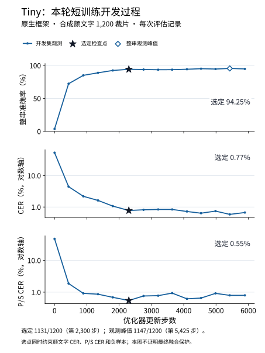

以下单裁片结果基于新保留集中的 **2,400 张颜文字图像**，使用原始识别字符串；整串准确率、CER 与 P/S CER 分别计算，不作宽度、大小写或空格归一化。

| 模型阶段 | 整串正确 | 整串准确率 | CER | P/S CER |
| --- | ---: | ---: | ---: | ---: |
| 生产文字基线 | 159/2400 | 6.63% | 35.95% | 37.97% |
| Tiny 官方预训练 | 0/2400 | 0.00% | 55.57% | 52.99% |
| Tiny 专项微调，开发选定 | **2288/2400** | **95.33%** | **0.74%** | **0.30%** |
| RepSVTR 扩展字符头初始化 | 0/2400 | 0.00% | 128.22% | 172.93% |
| RepSVTR 专项微调 | 552/2400 | 23.00% | 16.75% | 11.07% |

RepSVTR 的初始化参照是扩展字符头后的真实起点，不等同于原始官方识别器。CER 可超过 100%，表示插入等编辑错误总数超过标签字符数。Tiny 的直接通用替换门禁仍失败：保留裁片中有 82 次普通文字错误改写、1 次标点正确转错及 55 次标点错误改写，图形负样本新增 2 次非空输出。因此以下自动区域链路另行核验最终保护结果。

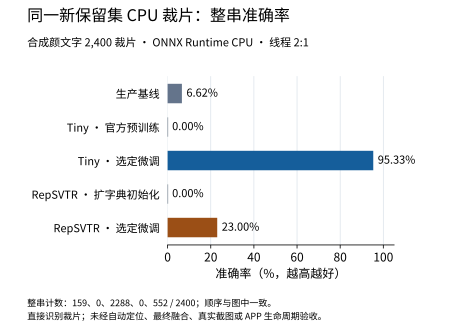

自动整图首测包含 **400 张图、300 个颜文字区域、400 个正文区域、60 个图形区域和 40 张负样本图**。推理只接收原图及六字段输入清单；真值区域、字符范围与墨迹掩码仅用于测量。

| 自动整图链路 | 颜文字整串正确 | 整串准确率 | CER | P/S CER |
| --- | ---: | ---: | ---: | ---: |
| 生产基线 | 4/300 | 1.33% | 74.99% | 72.87% |
| 基线 + 冻结 Tiny 专项融合 | **10/300** | **3.33%** | **73.98%** | **71.48%** |
| 基线 + RepSVTR 测评参照 | 5/300 | 1.67% | 74.83% | 72.47% |

Tiny 有 221 次实际专项路由、7 次错误转整串正确及 1 次颜文字正确转错，净增 6 个正确区域。最终正文的正确转错、错误改写、边界新增错误与文本删除均为零；负样本及图形新增非空输出均为零。图形和负样本实际专项误路由也为零。RepSVTR 的保留结果仅用于报告，不改变开发集选定的 Tiny。

**本轮达到已确认的相对研究门槛，但自动链路颜文字整串准确率仅为 3.33%。** 候选与颜文字相交命中为 300/300，完整墨迹覆盖为 264/300，实际专项路由的安全完整覆盖为 83/300；相交命中不能替代完整定位或最终识别成功。单裁片的 95.33% 不代表自动整图或真实截图准确率。真实图及应用生命周期未验收，模型仍未启用、未替换生产文字基线。

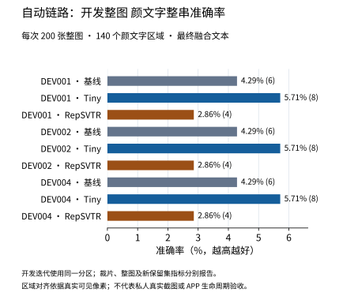

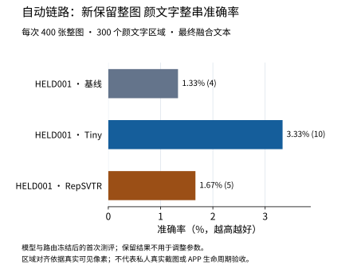

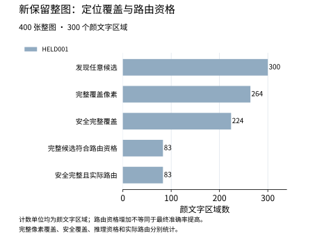

新预算实际使用 **1,266.452/7,200 GPU 秒**；旧账本的 7,011.043364 秒独立保留。本轮全量 CPU 测试曾因约 192 MiB 临时夹具触发产物超限并停止，失败日志保留；用户删除该临时目录后，夹具改为小型文件大小边界控制，新的完整测试通过。最终产物与外部测试夹具、公开图表统一核算，不以单目录大小代替总量。

整图 CPU 测量包括真实基线与两个专项模型：冷加载及首图 1.83 秒，预热 p50/p95 为 346.95/613.17 ms，峰值 RSS/采样 Private 为 583.63/605.41 MiB，线程数为 2/1。该测量不是仅部署 Tiny 的成本，也不是应用端到端性能。Tiny 单裁片预热 p50/p95 为 3.21/4.03 ms，完整分阶段资源见图表及汇总。

匿名数值、来源摘要、首用时序及完整 22 张图见 [本轮汇总](docs/evaluation/quality-optimization-20261012/summary.json) 与 [图表目录](docs/evaluation/quality-optimization-20261012/figures/)。[可运行绘图源码](docs/evaluation/quality-optimization-20261012/build_charts.py) 显式接收已完成的开发报告及成对首测报告，校验冻结绑定后生成图表；依赖本地合法取得的固定字体与实验输出，不随源码分发原图、标签、预测、字体或模型权重。不同数据集的历史结果保留在下文，不合并成同一准确率趋势。

### 通用预训练识别器研究

本轮微调固定官方 PP-OCRv6 Tiny 与 OpenOCR RepSVTR Mobile，使用原创合成数据、原始 Unicode 标签和独立开发/保留分区。训练、输入探针及 GPU 开发评估累计预算为 7,200 秒；训练结束、开发集选择冻结后才执行新保留集首测。

| 分区 | 正样本组 | 负样本组 | 图片数 | 用途 |
| --- | ---: | ---: | ---: | --- |
| 训练 | 10,000 | 1,000 | 31,000 | 微调与训练词表扩展 |
| 开发 | 1,000 | 100 | 2,100 | 检查点选择及预算内改进 |
| 新保留 | 2,000 | 200 | 4,200 | 选择冻结后首测 |

标签、配方家族及跨分区像素互斥，字体和词汇原子可以共享。完整画布直接输入识别器；该评测不包含检测器定位和 APP 自动区域选择。旧保留资料已登记为开发回归材料，不能证明本轮泛化能力。

两家族均完成有效微调及预算内暖启实验。累计 GPU 用时为 **7,011.04/7,200 秒**，包含探针、GPU 开发评估、保存、清理及异常退出审计区间。训练后停止新增 GPU 任务；最终保留各家族首轮最佳候选。软件版本、生产权重和活动模型未改动。

#### 四轮训练与开发选择

| 运行 | 实际更新步数 | 本轮已更新权重的最佳 GPU 开发整串匹配 | 本轮最佳步骤 | 最终家族选择 |
| --- | ---: | ---: | ---: | --- |
| `ppocrv6-tiny-exp-20261011-001` | 17,309 | 393/2,100 | 1,222 | 保留首轮 |
| `ppocrv6-tiny-exp-20261011-002` | 7,321 | 199/2,100 | 1,846 | 无改善；未生成新最佳候选 |
| `repsvtr-mobile-exp-20261011-001-run1` | 24,050 | 388/2,100 | 18,000 | 保留首轮最佳检查点 |
| `repsvtr-mobile-exp-20261011-002` | 13,448 | 387/2,100 | 2,500 | 暖启候选未替换父候选 |

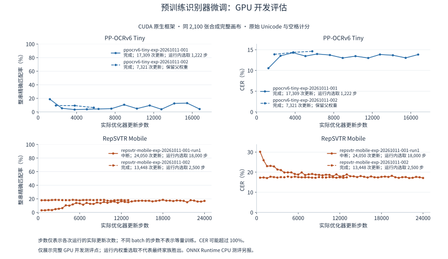

RepSVTR 首轮因 Windows 进度文件原子替换失败而退出；表中 24,050 步是实际更新量，不表示正常完成。其第 18,000 步最佳权重与日志单独冻结，暖启第二轮正常完成。Tiny 两轮正常完成；第二轮冻结骨干参数及统计量，调整空目标损失权重，所有开发检查点均未超过父候选，因此不把父权重计作新的训练成果。Tiny 首轮全程覆盖 31,000 个训练样本，但第 1,222 步所选检查点仅接触 19,552 个独立样本和 637 个负样本；全程覆盖不等于所选模型覆盖。

训练曲线使用原生 CUDA 后端；最终比较使用 ONNX Runtime CPU。RepSVTR 首轮最佳模型在 CPU 开发集上为 379/2,100，暖启最佳为 378/2,100，按整串匹配优先、同分时 CER 优先的冻结规则保留父候选。原生与 ONNX 多宽度、多批量数值和 CTC 解码探针通过，不代表整套数据在不同后端上逐项完全相同。

#### 新保留裁片首测

模型与实现冻结后，按同一完整合成画布执行 4,200 张新保留图首次 CPU 比较。以下五个模型的结果来自同一次配对评测，未使用保留结果调参。

| 模型 | 整串精确匹配 | 整体 CER | 普通文字匹配 / 2,200 | 颜文字匹配 / 800 | 颜文字 P/S 符号 CER | Emoji 匹配 / 200 |
| --- | ---: | ---: | ---: | ---: | ---: | ---: |
| 当前生产文字基线 | 215/4,200（5.12%） | 24.27% | 70 | 12 | 13.23% | 0 |
| Tiny 官方预训练 | 239/4,200（5.69%） | 25.17% | 65 | 6 | 22.33% | 0 |
| Tiny 首轮微调 | **954/4,200（22.71%）** | **9.82%** | **811** | 0 | 58.38% | 0 |
| RepSVTR 官方预训练 | 172/4,200（4.10%） | 27.24% | 3 | 0 | 30.65% | 0 |
| RepSVTR 首轮微调 | 667/4,200（15.88%） | 14.86% | 542 | 0 | 59.99% | 0 |

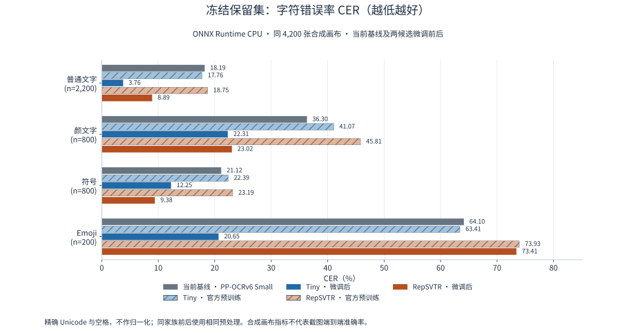

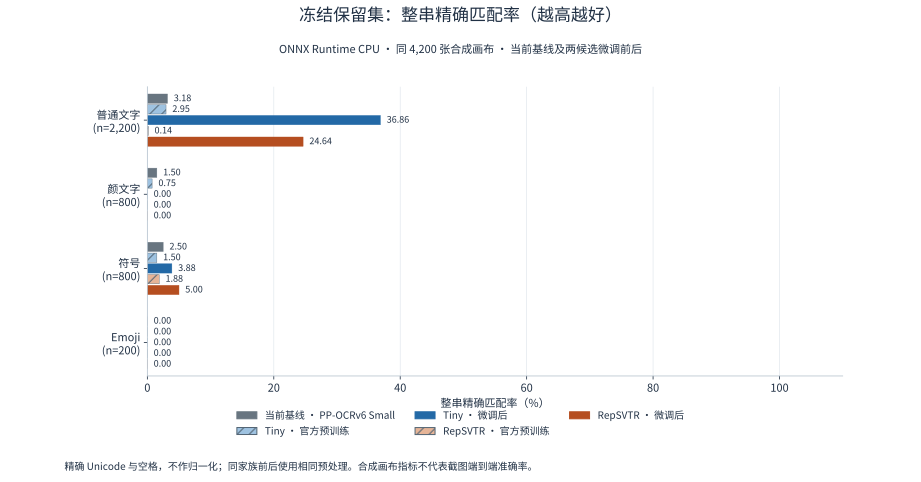

本数据包含首尾空格、连续空格、组合字符及序列编号，严格保留原始标签。有限生成配方和字体共享使结果不能代表自然截图总体准确率。颜文字标签中的数字和空格可降低总体 CER，不能据此认定表情符号改善：两项微调模型的颜文字整串均为 0/800，符号 CER 均明显退化。两项扩展词表覆盖全部保留标签码点，Emoji 整串仍为 0/200；Tiny 的 Emoji 码点 CER 为 20.65%，组合簇 CER 为 33.00%，不能将字典覆盖解释为识别成功。

| 保护指标 | Tiny 微调 | RepSVTR 微调 | 分母及判定 |
| --- | ---: | ---: | --- |
| 普通文字基线正确转错 | 12 | 36 | 2,200；要求 0 |
| 普通文字错误改写 | 1,382 | 1,647 | 输出不同于基线且仍不等于标签；要求 0 |
| 标点文本基线正确转错 | 19 | 16 | 800；要求 0 |
| 空白非空输出 | 5 | 31 | 100；基线为 0 |
| 图形非空输出 | 83 | 84 | 100；基线为 87 |
| 图形新增非空输出 | 11 | 13 | 基线原先为空的图形；要求 0 |

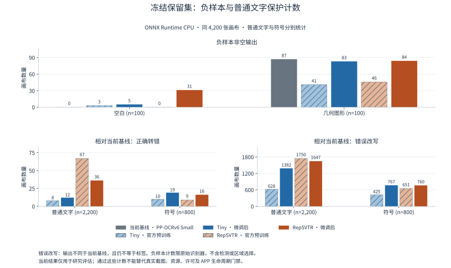

**通用替换判定：拒绝。** 整体 CER 和普通文字总匹配改善未满足逐项普通文字保护、颜文字改善及负样本门禁。两项研究候选均保持 `promote: false`、`enabled: false`；不按新保留结果改选检查点。

#### 单裁片 CPU 资源

本机 Intel Core Ultra 9 275HX、Windows x64、ONNX Runtime 1.31.0，使用 CPUExecutionProvider，intra-op/inter-op 线程数为 2/1；五模型子进程串行运行。每模型三次预热，p50/p95 统计 4,200 次实际识别，包含预处理和解码。冷时延包括模型构建、接口校验及首张识别；基线构建三个固定 session。此表限识别器，不含自动检测或 APP。

| 模型 | 冷加载及首张（ms） | 预热后 p50 / p95（ms） | 峰值 RSS / Private（MiB） |
| --- | ---: | ---: | ---: |
| 当前基线 | 681.75 | 18.60 / 27.36 | 168.13 / 176.30 |
| Tiny 官方预训练 | 279.04 | 4.69 / 5.98 | 110.08 / 120.18 |
| Tiny 微调 | 277.36 | 4.69 / 6.01 | 110.46 / 120.75 |
| RepSVTR 官方预训练 | 342.21 | 18.28 / 25.34 | 146.20 / 158.62 |
| RepSVTR 微调 | 288.46 | 18.43 / 25.57 | 144.42 / 156.91 |

RSS 使用 Windows 原生峰值 working set；Private 为 10 ms 间隔采样及退出时读数，不能视为连续峰值上界。资源测量是当前主机证据；正式研究模型交付预算仍需独立确认。训练、导出、冻结与回归入口见[微调工具说明](tools/PretrainedOcr/README.md)。定位及融合另见[区域研究说明](tools/RegionKaomoji/README.md)。

### 自动定位、专项识别与融合

独立链路保留通用文字基线，使用首遍文字/几何和原图像素发现候选。只有自动裁片的同模型两种实际像素视图原始字符串一致、额外结构和正文边界证据成立时才允许融合；不按跨模型原始分数替换。真值区域与墨迹掩码仅在推理结束后计量，不作为候选输入。整图字符串按已声明的几何阅读顺序拼接，基线与研究采用相同口径。

| 定位与路由指标 | 开发：200 张 / 120 个颜文字区域 | 新保留：400 张 / 280 个颜文字区域 |
| --- | ---: | ---: |
| 至少一个候选相交 | 120/120 | 279/280 |
| 覆盖全部实际墨迹 | 118/120 | 274/280 |
| 完整覆盖且不吞正文 | 117/120 | 271/280 |
| 实际送入专项的安全完整覆盖 | 54/120 | **0/280** |
| 实际送模型候选数 | 56 | **0** |
| 正文实际误路由 | 0/180 | 0/400 |
| 图形实际误路由 | 0/40 | 0/80 |


| 融合后的颜文字指标 | 开发整串 / 120 | 开发 CER | 新保留整串 / 280 | 新保留 CER |
| --- | ---: | ---: | ---: | ---: |
| 生产基线 | 3 | 75.00% | 8 | 69.61% |
| Tiny 区域链路 | 4 | 74.43% | 8 | 69.61% |
| RepSVTR 区域链路 | 3 | 75.00% | 8 | 69.61% |


开发集上 Tiny 有一次实际融合，颜文字整串由 3/120 增至 4/120；安全完整自动裁片的原始识别为 22/54，不能将其写成最终整图成功数。新保留集虽发现 279 个区域，冻结资格规则实际没有路由任何专项裁片，两模型都未执行保留集专项视图识别，最终逐项保留基线：整图匹配 93/400，颜文字匹配 8/280。该结果揭示资格规则的保留泛化失败，不证明专项识别有效。

两链路在开发集和保留集均无新增正文错误、文字删除或负样本非空输出；保留正文保持 228/400 正确。保留图形负样本仍有基线既有非空输出 40/40，空白为 0/40。零路由条件下的零误改不能作为有效增强链路通过门禁的依据。

400 张保留整图实际 CPU 耗时 347.72 秒；冷加载及首图 2.40 秒，预热后 p50/p95 为 750.82/1,501.36 ms，峰值 RSS/采样 Private 为 649.59/675.74 MiB，线程数 2/1。测量包括真实基线检测、方向、识别、候选处理及两个专项 session 加载；因实际专项视图数为零，不代表有路由负载时的完整识别成本。该评测未与其他模型推理并行，期间有文档生成活动，资源值不是隔离性能基准。

**区域链路判定：不具备接入资格。** 新保留集没有颜文字改善，规则与模型不因该结果重调；生产模型与 APP 保持原状态。坐标、父文本摘要、上下文复读、并排完整表达式保护与复现入口见[区域研究说明](tools/RegionKaomoji/README.md)。

### 本轮已查看资料回归

冻结的两项首轮候选另在旧原创 `regression` 分区和既有私人裁片上执行开发回归。旧合成数据使用完整画布；私人资料为此前已查看的人工裁片，均不构成新的独立泛化或自动定位验收。

| 旧原创回归：208 张 | 基线 | Tiny 微调 | RepSVTR 微调 |
| --- | ---: | ---: | ---: |
| 整串精确匹配 | 29/208 | 80/208 | 54/208 |
| 整体 CER | 18.19% | 11.83% | 16.36% |
| 普通文字正确转错 / 116 | — | 23 | 23 |
| 普通文字错误改写 / 116 | — | 47 | 74 |
| 颜文字精确匹配 / 38 | 0 | 3 | 0 |
| 负样本非空输出 / 12 | 6 | 6 | 0 |

Tiny 在旧回归新增一次空白非空输出。两候选均未满足逐项普通文字保护；整体指标改善不能替代该门禁。

| 私人回归：22 条确定标签 | 基线 | Tiny 微调 | RepSVTR 微调 |
| --- | ---: | ---: | ---: |
| 普通文字精确匹配 / 14 | 14 | 5 | 0 |
| 普通文字 CER | 0.00% | 12.59% | 25.19% |
| 空白非空输出 / 4 | 0 | 0 | 1 |
| 图形非空输出 / 4 | 4 | 4 | 2 |

私人资料共 26 条，4 条颜文字因 Unicode 标签不能唯一确定而排除精确统计，未用于训练。该回归不能证明真实颜文字改善。公开文件仅保留[匿名计数与报告哈希](docs/evaluation/pretrained-20261012/development-regression.json)，不提供私人原图、标签、逐项预测或路径。

### 历史训练迭代

| 历史标记 | 训练记录 | 最佳开发整串匹配 | 最佳轮次 | 开发集 | 保留评测记录 |
| --- | ---: | ---: | ---: | --- | --- |
| v1 | 24 轮 | 33/262（12.60%） | 23 | 原始冻结集 | 未找到可核验报告 |
| v2 | 96 轮 | 227/262（86.64%） | 91 | 与 v1 相同 | 未找到可核验报告 |
| v3 | 日志仅记录第 1–8 轮 | — | — | 缺少有效训练绑定 | 训练未完成，缺少冻结汇总 |
| v4 | 128 轮 | 211/299（70.57%） | 114 | 扩充冻结集 | 已完成，拒绝接入 |

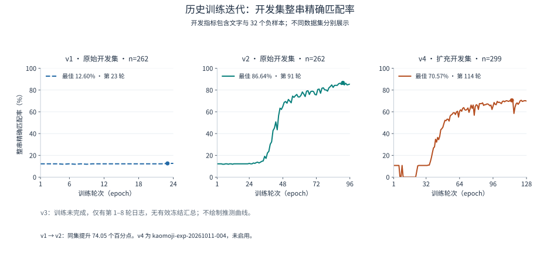

v1、v2 使用相同开发集，最佳整串匹配率提高 **74.05 个百分点**。v4 使用扩充数据和不同字符表，开发集分母由 262 变为 299，两者不构成同口径趋势。历史开发指标均包含 32 个负样本，不能解释为颜文字准确率；模型选择仅使用开发集。

已完成训练均采用 seed `20261011`、batch `96`、学习率 `0.001`、CUDA 12.8 和 PyTorch 2.10.0。v1/v2 为 312,915 参数，v4 为 345,939 参数。原始开发集包含 170 条颜文字、60 条普通文字及 32 条负样本；扩充开发集包含 207 条颜文字、60 条普通文字及 32 条负样本。

### 历史冻结保留集比较

两套历史数据分别比较固定文字基线与同一冻结候选 `kaomoji-exp-20261011-004`。当时按冻结模型执行保留评测，未生成新模型版本。这些结果已经被查看，在本轮微调研究中仅用于开发回归，不再作为新的保留证明。

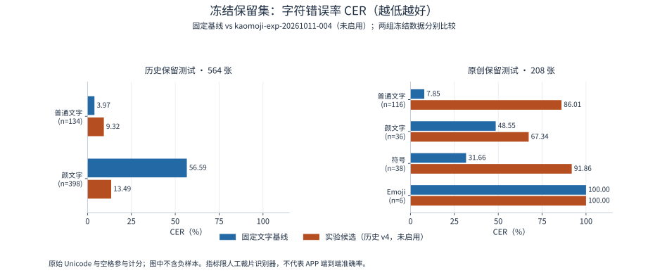

**历史合成保留集**：训练/开发/测试分别为 12,610 / 299 / 564 张，测试包含 398 条颜文字、134 条普通文字和 32 条负样本。

| 类别 | 样本数 | 基线整串精确匹配 | 候选整串精确匹配 | 基线 CER | 候选 CER |
| --- | ---: | ---: | ---: | ---: | ---: |
| 颜文字 | 398 | 9/398（2.26%） | 163/398（40.95%） | 56.59% | 13.49% |
| 普通文字 | 134 | 93/134（69.40%） | 55/134（41.04%） | 3.97% | 9.32% |

候选将 5 条基线正确的颜文字、49 条基线正确的普通文字识别为错误；候选对 32 条合成负样本均输出空串。颜文字收益未抵消普通文字退化。历史数据含网页提取语料与共享后备字体，不作为开放许可数据集发布。完整记录见 [专项测评报告](tools/KaomojiOcr/RESULTS.md)。

**原创冻结数据集**：共 1,193 张图片；训练 459、开发 114、保留测试 208、回归 208、独立验收 204。使用原创文本、虚构记录与几何负样本，字体采用固定官方 OFL 版本；无法可靠渲染的变体排除并统计。

保留测试集（`test`）结果：

| 类别 | 样本数 | 基线整串精确匹配 | 候选整串精确匹配 | 基线 CER | 候选 CER |
| --- | ---: | ---: | ---: | ---: | ---: |
| 普通文字 | 116 | 32/116（27.59%） | 0/116（0.00%） | 7.85% | 86.01% |
| 颜文字 | 36 | 0/36（0.00%） | 0/36（0.00%） | 48.55% | 67.34% |
| 符号 | 38 | 0/38（0.00%） | 0/38（0.00%） | 31.66% | 91.86% |
| Emoji | 6 | 0/6（0.00%） | 0/6（0.00%） | 100.00% | 100.00% |

其他分区的普通文字结果：

| 分区 | 样本数 | 基线整串精确匹配 | 候选整串精确匹配 | 基线 CER | 候选 CER |
| --- | ---: | ---: | ---: | ---: | ---: |
| 独立验收（`acceptance`） | 116 | 26/116（22.41%） | 0/116（0.00%） | 8.06% | 85.63% |
| 回归（`regression`） | 116 | 19/116（16.38%） | 0/116（0.00%） | 9.14% | 84.00% |

负样本非空输出数（越低越好）：

| 分区 | 空白：基线 / 候选 | 几何图形：基线 / 候选 |
| --- | ---: | ---: |
| 保留测试 | 0/6 / 0/6 | 6/6 / 5/6 |
| 独立验收 | 0/6 / 0/6 | 6/6 / 5/6 |
| 回归 | 0/6 / 0/6 | 6/6 / 6/6 |

三个分区中，双方在颜文字、符号和 Emoji 上均未取得整串成功；候选普通文字全部失败。基线在符号、Emoji 和图形负样本上也存在明显限制。完整类别、误改与组合簇指标见 [原创数据测评报告](tools/OcrDatasets/RESULTS.md)。各分区用途独立，不按分区顺序绘制迭代趋势。

### 私人回归与接入判定

已有私人回归资料共 26 条；4 条颜文字因 Unicode 标签无法唯一确认而排除，22 条进入精确统计。普通文字整串精确匹配为基线 **14/14**、候选 **0/14**；图形负样本非空输出为基线 **4/4**、候选 **2/4**；空白均为 **0/4**。这些资料此前已被查看，属于回归证据；真实颜文字精确改善尚无有效结论。

**接入判定：拒绝。** 候选未满足普通文字保护、负样本及真实精确改善要求，保持 `promote: false`、`enabled: false`。生产文字基线权重未变。本机 CPU 资源探针通过不构成质量门禁通过；模型与 APP 区域选择、取消及预览流程仍需独立验收。

### 指标与图表复现

[匿名指标数据](docs/evaluation/metrics.json) 包含训练曲线、开发集与保留集哈希、候选模型哈希、报告哈希及类别分母。图表由 Matplotlib 3.10.8 生成，使用已核验的 Noto Sans CJK OFL 字体；字体文件、私人标签、原图和逐项预测不进入文档资产。

```powershell
python tools/Documentation/plot_evaluation.py --font <已准备的 NotoSansCJKsc-Regular.otf> --preview artifacts/readme-evaluation-preview
```

本轮四次训练与新保留裁片的[匿名汇总](docs/evaluation/pretrained-20261012/summary.json)及整图链路的[匿名汇总](docs/evaluation/region-20261012/summary.json)分别附有生成收据，绑定实际报告、数据、模型及源码哈希。可离线重绘本轮八张图表：

```powershell
python tools/Documentation/plot_pretrained_evaluation.py --data docs/evaluation/pretrained-20261012/summary.json --font <已准备的 NotoSansCJKsc-Regular.otf> --output artifacts/pretrained-chart-reproduction
python tools/Documentation/plot_region_evaluation.py --data docs/evaluation/region-20261012/summary.json --font <已准备的 NotoSansCJKsc-Regular.otf> --output artifacts/region-chart-reproduction
```

该命令仅重绘匿名汇总图表，不执行推理或训练。绘图库属于文档生成环境，不加入推理依赖。模型权重或数据清单改变时，应新增评测记录并注明模型与数据身份；开发、保留测试和私人回归用途分别记录。

## 数据、许可与工具

原创文本、虚构记录、原创几何、生成图片与数据清单采用 CC0-1.0；生成器及其他代码采用 [GPL-3.0-or-later](LICENSE)。模型、运行时及字体遵循各自许可，源码许可不授予第三方资产的再分发权限。

私人截图、裁片、标签、网页语料、字体、模型权重、逐项预测与训练产物仅保存在本地忽略目录，不进入 Git 源码。运行时 ZIP 不包含私人资料；基线权重由独立模型包管理，其再分发须另行核验适用许可。网页提取语料不作为开放许可数据发布；私人资料不混入合成训练集。职业图标分类及训练属于 APP 工程。

- [原创数据生成、冻结与复现](tools/OcrDatasets/README.md)
- [颜文字训练与冻结测评工具](tools/KaomojiOcr/README.md)
- [文字基线 worker](scripts/local-ai-ocr-worker.py)
- [源码与依赖来源](docs/provenance/README.md)
