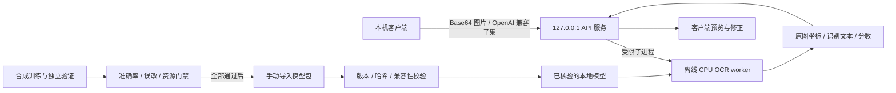

# LocalOCR

本地 OCR 训练、测评与推理服务工程。文字识别基线和专项训练工具来自 MentorRecorder；后续通过稳定接口供桌面软件和其他客户端调用。

**当前状态：源码与训练测评工具已初始化。本机 HTTP API、模型包更新和软件接入尚未实现。** 专项颜文字候选未通过接入门禁，不能作为生产默认模型。

## 工程范围

- CPU 离线文字 OCR 基线：固定本地模型、原图坐标和受限符号复读。
- 颜文字合成训练与冻结测评：支持 CUDA / MPS / CPU 设备选择，模型导出为 ONNX。训练与推理依赖分开维护。
- 本机 API 目标：`GET /v1/models` 和非流式 `POST /v1/chat/completions`，采用 OpenAI 兼容子集，仅监听 `127.0.0.1`，图片通过 Base64 传入。
- 模型更新目标：手动导入离线模型包，核验版本、哈希和运行时兼容性后启用，失败保留原版本。

API 的兼容范围和 OCR 结果结构将在实现及真实接口验证后形成版本化契约。OpenAI 兼容格式不意味着通用对话模型或完整 API 功能。

## 架构目标

下图为待实现的服务架构；当前可用入口仍为离线 worker 的命令行。



API 与 worker 必须分进程：基线 worker 的进程级审计钩子禁止连接、DNS 解析和端口绑定。服务不设置云端降级，也不在运行时下载模型或抓取图片 URL。

## 工具与验证

- [颜文字训练与测评说明](tools/KaomojiOcr/README.md)
- [冻结候选的测评记录](tools/KaomojiOcr/RESULTS.md)
- [文字 OCR 基线](scripts/local-ai-ocr-worker.py)
- [依赖及源码来源](docs/provenance/README.md)

在独立 Python 环境中安装训练依赖；Torch 按设备单独安装。仅检查工具契约时可运行：

```powershell
python -m pip install -r tools/KaomojiOcr/requirements-train.txt
python tools/KaomojiOcr/test_tools.py
python tools/LocalAiOcr/test_worker.py
```

基线推理另需合法取得、与 worker 大小及 SHA-256 一致的完整本地模型。依赖安装属于开发准备；推理期间不联网。现有 Windows 打包脚本沿用原基线的固定构建依赖，新 API 的自包含运行时尚待构建和验收。

职业图标识别属于 APP 的领域图像分类，由 MentorRecorder 工程维护；职业目录、图标资产、分类器权重与训练脚本不属于本工程范围。

## 数据与许可

私人截图、裁片、标签、预测、网页语料、字体、模型文件与训练产物均留在本地忽略目录。真实截图仅用于独立验证，不能混入合成训练集。模糊或无法唯一确定 Unicode 码点的样本不能用来宣布精确准确率。

代码采用 [GPL-3.0-or-later](LICENSE)。第三方模型、运行时、字体和游戏图标保留各自许可，不能从源码许可推断它们的再分发权限。网页语料不作为开放许可数据集发布。
