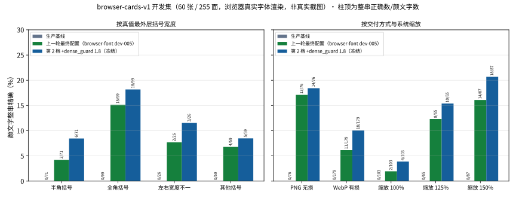
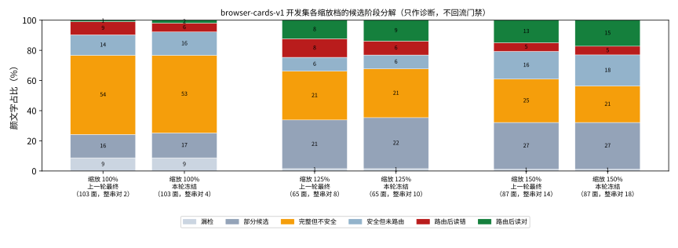
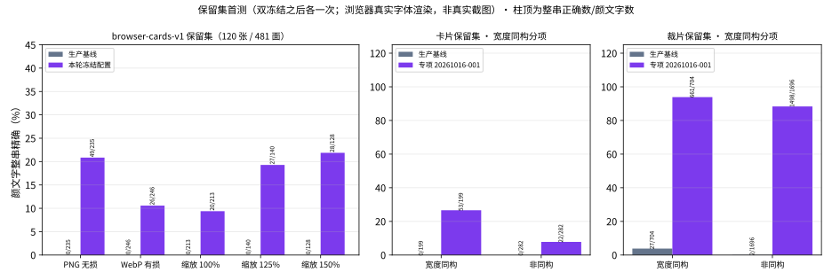

# 2026-10-16 括号对定位改进：形状族配对、最内配对与单字形致密守卫

[返回 README 评测结果](../../../README.md#评测结果) · [历次版本对比](../../../README.md#历次版本对比)

上一轮（浏览器字体轮）把浏览器真实字体渲染开发集 browser-cards-v1 的颜文字整串由 4/255 提高到 24/255，但仍有 1 处正文相交新增错误，研究门禁未过，两个保留集封存。提案阶段的只读计数显示，开发门禁的阻塞与 100% 缩放下真括号的流失都出在像素括号配对上，而不在识别：

- 场景 dev-0040 中，正文的全角 `（`（曲线形）与颜文字的 `］`（直角形）被配成一对，整行读数拼接以这对笔画的跨度为区域框，覆盖了正文像素；
- 系统缩放 100% 下，按真值框裁出的圆括号与方括号颜文字有 61/78 能找到括号对，经致密字形守卫后只剩 15/78（提案阶段计数；本轮诊断按 2 像素边距复算为 16/78）：抗锯齿晕边把括号与相邻字形粘成宽块，宽块被当作致密 CJK 字形而否决了括号笔画。

本轮是零 GPU 的 CPU 轮：不训练，复用上一轮的专项 `ppocrv6-tiny-exp-20261016-001` 与分类器 `kaomoji-crop-classifier-exp-20261016-001`（阈值 0.09），只新增两个结构化可选候选键。两键缺省时逐项复现旧输出。正文保护、路由资格、混合区域空白带、整行读数拼接的区域框与融合规则都不改。专项、分类器与配置保持 `promote=false`、`enabled=false`，生产链路、接口与模型包不变。

**结论：开发门禁与三份回归的硬条件都通过，双冻结写出，两个保留集各首测一次。** browser-cards-v1 开发集颜文字整串由 24 提高到 32/255（消歧后 25 → 33），dev-0040 的正文错误消失。browser-cards-v1 保留集首测为 75/481，同集生产基线为 0/481，正文与负样本零新增错误。browser-crops-v1 裁片保留集首测，专项 2159/2400，生产基线 29/2400。代价包括：known-input-001 开发探针的独立颜文字由 16/50 降到 13/50；形状族约束会删除小字号下检出为跨族的真括号对；放宽致密守卫后，内部含正文像素的宽括号对又会出现，由既有正文保护拦住。结果都是“浏览器真实字体渲染”结果，不代表真实截图上的识别表现。

## 两个新键

- **`candidate.pair_selection`**（`family_match`、`innermost_partner`，均为布尔值，至少一个为 true）。
  - 族约束以原子表为事实源：原子表 18 个声明对全部由同一形状族的镜像字形组成。curve 与 small-curve 属曲线族，right-angle 属直角族；左右笔画同族才配对，所有字号一律适用。
  - 最内配对：同一检测范围（整行或一个候选裁片）内多个括号对共享一条笔画时（笔画框各边差不超过 1 像素），只保留另一侧笔画最近的一对，一次判定，不迭代。
  - 筛选顺序为族约束、致密字形守卫、最内配对。整行先收集各块与整行的括号对，再统一筛选。
- **`candidate.dense_guard.maximum_width_ratio`**：只有宽度不超过自身高度该倍数的致密基础连通域（单个字形大小）可以否决括号笔画。这是对致密字形守卫的有意放宽，只影响形状证据。

**取值 1.8 在任何开发评测之前由渲染测量写定**，并由单元测试固定：
- 测量对象：评论正文词表 `CN_WORDS` 的 102 个 CJK 字形，每个单独渲染；
- 渲染器：登记 Noto 12–32 px 共 2,142 个样本，本机 Edge 微软雅黑 16–20 px、缩放 1.0/1.25/1.5、两种配色共 3,060 个样本；
- 方法：阈值 8 的基础掩码中，高度不低于字形墨迹高度 0.65 倍、宽度不低于自身高度 0.65 倍、密度不低于 0.4 的连通域取宽高比上界。

结果是 Edge 1.8、Noto 1.625（都来自 `云` 的下部连通域），取上界并向上取到 0.05。

| 测量 | 结果 |
| --- | --- |
| 原子表投影（每个声明对包住 `^_^`，核心阈值 80） | Noto 12–32 px 无跨族检出（`༼༽` 在登记字体中不可渲染）；Edge 540 个样本中跨族 24 个（缩放 100% 为 15，125% 为 4，150% 为 5），集中在 `〔〕` 与小字号的圆、方括号 |
| 放宽风险（纯正文 CJK 行、零字距：Noto 12–16 px 40 个样本，Edge 缩放 100% 两种配色 80 个样本） | 冻结配置、单开任一键、两键全开下，检出的括号对、括号对候选与可路由候选全部为 0 |

## 实现与证据顺序

- 实现开始时工作区干净（HEAD 8d062fb），先把将改动的 5 个源码文件快照到忽略目录，再改源码。零秒账本绑定已关闭的浏览器字体轮训练账本（已用 2376.438 秒），GPU 租约实测被拒。
- 全量测试与独立只读代码复核在源码清单快照之前完成。
  - 复核结论：批准，无 CRITICAL 与 HIGH。
  - 按复核意见补充的低风险修正：共享汇总函数、逐图预测只按换行符切分、改名与测试补强。之后全量测试 1195 passed、10 skipped。
- 等价性探针：用 14 份已记录报告各自绑定的配置（不含新键）重放 1,122 个场景与截图，候选、路由、决策、区域、上下文与视图预算 0 不一致。之后写源码清单快照（74 个文件），不再改 `tools/`、`scripts/`、`localocr/`。
- known-input 探针报告新增逐图预测文件的 SHA。探针回归证明改为按逐图预测与截图重新打分，不信任报告自报的汇总。上一轮的探针报告因没有该字段，不能作为证明。

## 整图开发矩阵（browser-cards-v1 开发集，60 张 / 255 面）

所有档位使用冻结专项与分类器、宽度 `exact`、核心阈值 80、桥接比例 0.45，每档在上一保留档上加一个键。保留条件：消歧口径的正文保护四个计数与负样本两个计数都不增加，并且正文计数减少或消歧整串增加；持平不保留。

| 配置 | 严格整串 / 255 | 消歧后 | CER | 仅外括号宽度不符 | 实际路由 | 正文新增错误（严格 / 消歧后） | 负样本新增非空 | 决定 | 单张 p50 |
| --- | ---: | ---: | ---: | ---: | ---: | ---: | ---: | --- | ---: |
| 生产文字基线 | 0 | 0 | 94.85% | — | — | — | — | — | — |
| 上一轮最终配置（起点） | 24 | 25 | 85.23% | 3 | 137 | 2 / 1 | 0 | — | 2.90 s |
| 第 1 档 +`pair_selection` | 24 | 25 | 85.23% | 3 | 133 | 1 / 0 | 0 | 保留（正文计数减少） | 3.19 s |
| **第 2 档 +`dense_guard` 1.8（冻结）** | **32** | **33** | **82.42%** | 2 | 154 | 1 / 0 | 0 | 保留（消歧整串增加） | 3.23 s |
| 第 3 档 +`small_text_shape` 22/2 | 32 | 33 | 82.42% | 2 | 158 | 1 / 0 | 0 | 持平，不保留 | 3.49 s |

剩下的 1 处严格正文计数在 dev-0041：一个合法尾缀残片紧贴颜文字右侧，按尾缀歧义口径消解为 0，与上一轮相同。dev-0040 的正文错误在第 1 档起消失。

| 分项 | 颜文字数 | 上一轮最终 → 本轮冻结 |
| --- | ---: | ---: |
| 半角括号 | 71 | 3 → 6 |
| 全角括号 | 99 | 15 → 18 |
| 左右宽度不一 | 26 | 2 → 3 |
| 其他括号 | 59 | 4 → 5 |
| PNG 无损交付 | 76 | 13 → 14 |
| WebP 有损交付 | 179 | 11 → 18 |
| 系统缩放 100% / 125% / 150% | 103 / 65 / 87 | 2 → 4 / 8 → 10 / 14 → 18 |

## 诊断（只读，只用开发集，不回流任何门禁或冻结）

| 计数 | 上一轮最终 | 第 1 档 | 第 2 档（冻结） |
| --- | ---: | ---: | ---: |
| 候选证据中的唯一括号对 | 96 | 82 | 122 |
| 其中跨族（曲线配直角） | 3 | 0 | 0 |
| 其中位于颜文字真值上的跨族对（族约束删除的颜文字括号对） | 1 | 0 | 0 |
| 内部含正文真值像素（>40）的括号对 | 10 | 2 | 10 |
| 经这些括号对路由的候选 | 6 | 2 | 6 |

第 2 档恢复的括号对里，又出现内部含正文像素的宽对（10 个，路由 6 个）。它们没有造成正文错误：既有正文保护与整行拼接规则照常拦住。按真值框裁出的圆括号与方括号颜文字上：

| 系统缩放 | 颜文字 | 有括号对 | 只有跨族对（族约束的代价） | 旧守卫后仍有 | 单字形守卫 1.8 后仍有 | 族约束 + 守卫 + 最内配对后仍有 |
| --- | ---: | ---: | ---: | ---: | ---: | ---: |
| 100% | 78 | 61 | 13 | 16 | 36 | 29 |
| 125% | 55 | 39 | 2 | 25 | 27 | 26 |
| 150% | 63 | 51 | 0 | 36 | 41 | 41 |

系统缩放 100% 下仍以“完整但不安全”（53/103）和“部分候选”（17/103）为主。这两类由路由资格、混合区域空白带与邻近正文重叠决定，本轮按约定不改，只报告。

## 回归（冻结配置）

| 数据 | 上一轮最终配置 | 本轮冻结配置 | 正文与负样本 |
| --- | ---: | ---: | --- |
| 记录卡片 v4 开发集（252 面） | 5 | 5（消歧后 5） | 零新增错误 |
| 原子混合 v3 开发集（164 面） | 27 | 28 | 零新增错误 |
| known-input-001 开发探针（已知输入真实截图，50 条独立颜文字，非独立） | 16 | **13** | 69 行正文零丢失 |
| 同上，正文内嵌颜文字（35 处） | 10 | 10 | — |

三份回归的硬条件全部满足：正文零新增、负样本零新增、探针零丢失正文行，且总体非空。探针由双冻结按逐图预测与截图重新打分后判定。**代价**：探针独立颜文字由 16 降到 13（相对生产基线仍为 11 面由错转对、0 面由对转错），本轮未逐面归因；按约定，回归上的颜文字整串只报告，不回退档位。

## 冻结与保留集首测

- 在本轮根内重跑 browser-crops-v1 dev 四模型裁片评测，结果与上一轮逐项相同：新专项 1090/1200、上一专项 227、生产基线 2、官方 Tiny 1。
- 裁片选择冻结选定 `ppocrv6-tiny-exp-20261016-001`，预算凭据为专项自身已关闭的训练账本（用户决定 [8a]）；整图选择冻结绑定本轮零秒账本。
- 双冻结按既有守卫重算开发门禁与三份回归证明，未修改任何守卫，也没有出现拒绝。

保留集各首测一次，首用凭据先于读图写出，首测后不调参：

| 保留集 | 生产基线 | 本轮 | 其他 |
| --- | ---: | ---: | --- |
| browser-crops-v1 heldout 颜文字（2,400 张裁片） | 29 | **2159**（专项原始读数） | 上一专项 407、官方 Tiny 25；空白、图形、emoji 均无新增非空 |
| browser-cards-v1 保留集颜文字（120 张 / 481 面） | 0 | **75**（消歧后 75） | CER 95.30% → 80.01%；75 面由错转对（路由有效性口径 73 面）、0 面由对转错；正文 4,854 区零新增错误，负样本零新增；研究门禁通过 |

browser-cards-v1 保留集分项：PNG 49/235、WebP 26/246；缩放 100% 20/213、125% 27/140、150% 28/128；半角 13/188、全角 48/168、宽度不一 8/40、其他括号 6/85。专项只处理被路由的裁片。裁片保留集的普通文字与标点上仍有 8 + 5 个基线读对的裁片被它读错，这类内容由整图正文保护负责。

**宽度同构分项**（只报告，总数与门禁不变）：把核心键的括号字符 NFKC 规范化后，与专项谱系的训练行比对，训练行指 atoms-corpus-v1 train 与 browser-crops-v1 train，共 8,832 个规范化核心键。

| 保留集 | 宽度同构：颜文字 / 基线 / 本轮 | 非同构：颜文字 / 基线 / 本轮 |
| --- | --- | --- |
| browser-cards-v1 | 199 / 0 / 53 | 282 / 0 / 22 |
| browser-crops-v1 | 704 / 27 / 661 | 1,696 / 2 / 1,498 |

整图保留集上，宽度同构的颜文字整串正确率（26.6%）明显高于非同构（7.8%）。这部分改善有一块来自训练中见过只差括号宽度的同核心组合，不能全部算作对新组合的泛化。

## 实现中的偏离

- **修订一**：`CURRENT` 改指本轮后，裁片生成测试夹具改为从 `rp.CURRENT` 派生单元 profile（只改测试）。
- **修订二**：测量值与投影、风险测量结果，见上。
- **修订三**：复核后的低风险修正。另有两处记录：
  - 两对的两侧笔画都在 1 像素内重合时，两对都保留；
  - 原子表投影的 Edge 部分由测量脚本逐字号记录，不放进单元测试。

结论口径：所有整图与裁片结果都是“浏览器真实字体渲染”（Edge 与 Windows 系统字体）或合成数据上的结果，不代表真实截图上的识别表现；known-input-001 只是开发探针。研究专项、分类器与配置仍未满足接入条件，未替换生产文字基线。匿名汇总、绑定 SHA 与图表见 [本轮汇总](summary.json)、[图表](figures/) 与 [可运行绘图源码](build_charts.py)；逐图预测、诊断明细、渲染页面与日志位于忽略目录 `artifacts/bracket-pairs-20261016/`。
