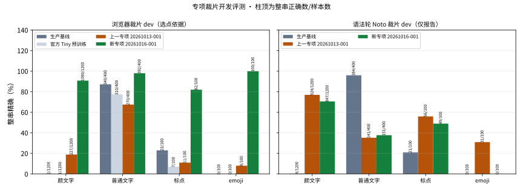
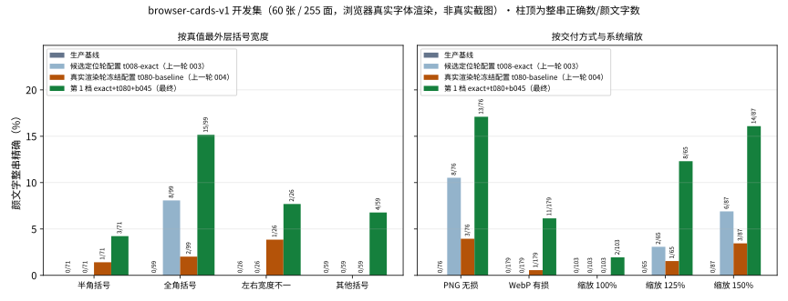

# 2026-10-16 浏览器真实字体识别改进：用浏览器渲染裁片重训专项与路由分类器

[返回 README 评测结果](../../../README.md#评测结果) · [历次版本对比](../../../README.md#历次版本对比)

上一轮建立的浏览器真实字体渲染集 browser-cards-v1 显示：专项 `ppocrv6-tiny-exp-20261013-001` 与路由分类器只在 HarfBuzz/FreeType 加 OFL Noto 的合成裁片上训练过，从未见过浏览器用微软雅黑及回退字体在三档系统缩放与 WebP 压缩下画出的字形；同时外括号宽度裁决把全角真值改成半角。本轮用本机 Edge 渲染新的训练裁片，从上一专项续训一个 Tiny 专项，并用 CPU 重训裁片分类器，最外层括号宽度一律取专项从像素读出的结果（`exact`）。系统字体只在本机渲染，不复制、不分发；由此训练出的权重与裁片只放忽略目录，任何发布都需另做许可审查。候选专项与分类器保持 `promote=false`、`enabled=false`，生产链路、接口与模型包不变。

**结论：浏览器真实字体渲染开发集的颜文字整串由上一版本的 4/255（候选定位轮行为 8/255）提高到 24/255，但仍有 1 处正文相交新增错误，研究门禁未过；既有守卫拒绝双冻结，两个保留集继续封存，未首测。** 本轮按“开发集测量完成、保留集未首测”收尾。

## 数据：浏览器裁片集 browser-crops-v1

生成器 `localocr.browser-crop-data.20261016.v1`（种子 20261016）复用上一轮的浏览器渲染会话：Playwright 1.63.0 驱动本机 Edge 155，只加载本地页面，非本地请求一律中止，计数为 0。每页仿制记录卡片配色，单列约 24 行，每行一个目标片段及左右邻近正文；每页独立抽取系统缩放（100%/125%/150%）与字号（16–20 px），约一半页面经 WebP（质量 70–95）有损编码后解码再切裁片。真值墨迹来自背景截图与 Custom Highlight 区间着色截图，裁片框为墨迹框加 2–6 设备像素边距。

| 分区 | 行数 | 构成 |
| --- | ---: | --- |
| train | 16,000 | 浏览器裁片 11,200 + 语法轮 Noto 合成裁片按种子分层抽样副本 4,800（逐行记录来源） |
| dev | 2,000 | 全为浏览器裁片，用于专项裁片选点与分类器阈值 |
| heldout | 4,000 | 全为浏览器裁片，已封存，未读取 |

- 类别比例与语法轮一致：颜文字 60%，普通文字 20%，标点、emoji、空白、图形各 5%。
- 宽度家族内的最外层括号按半角 / 全角 / 左右不一致分层抽样，实测 train 浏览器颜文字 46% / 44% / 10%，家族以外的原子表括号（记为 `none`）占 20%。颜文字两侧以不留或留 1 个空格的方式贴近正文；与尾缀同形的残片不紧贴颜文字右侧。
- 颜文字核心按语法分区：train 只用 train 分区核心，dev 与 heldout 各用自己的分区；完整标签与解码像素跨分区互斥。生成与校验不读取 browser-cards-v1 保留集。
- train 中没有专项词表外的字符，续训不需要扩表。生成 3,737 秒；排除 229 行（字形未被浏览器字体覆盖 221、墨迹越出卡片 6、像素重复 2）。
- 首次完整生成在最后的校验阶段失败（复制的语法轮颜文字按解析重算核心键与生成时的组合键不符），第二次生成随一次代理会话进程结束被中断；两次的记录均保留在忽略目录，数据未用于训练或选点，修正后从头生成。

## 模型

- **专项 `ppocrv6-tiny-exp-20261016-001`**：以 `ppocrv6-tiny-exp-20261013-001` 的选定权重为起点，经跨轮次续训准备（父谱系按外部锚定的训练凭据 SHA 校验，旧 token 切片逐字节保留，新增字符 0）。Tiny，batch 8，学习率 1e-4，`face-pareto` 选点，每 120 秒评一次。GPU 账本上限 7,200 秒，实际 1 次训练 2,376 秒（18 轮，选第 35,054 步）。ONNX 导出的 CPU 对照最大绝对误差 9.7e-6。
- **分类器 `kaomoji-crop-classifier-exp-20261016-001`**：CPU 训练 40 轮，阈值在浏览器裁片 dev 上按非颜文字误报率不超过 0.5% 选为 0.09；dev 三类 2,000 张全部分对，ONNX 对照最大差 2.7e-5。

## 专项裁片开发评测

| 模型 | 浏览器裁片 dev 颜文字 / 1,200 | 颜文字 CER | 普通文字 / 400 | 标点 / 100 | emoji / 100 | 语法轮 Noto 裁片 dev 颜文字 / 1,200（仅报告） |
| --- | ---: | ---: | ---: | ---: | ---: | ---: |
| 生产文字基线 | 2 | 63.95% | 349 | 23 | 0 | 4 |
| 官方 Tiny 预训练 | 1 | 68.79% | 310 | 7 | 0 | — |
| 上一专项 20261013-001 | 227 | 27.34% | 270 | 11 | 8 | 924 |
| **新专项 20261016-001** | **1,090** | **1.39%** | 392 | 82 | 100 | 847 |

空白与图形负样本在浏览器裁片 dev 上没有新增非空输出。专项只处理被路由的裁片，不作通用替换：在普通文字和标点上它仍会把 3 + 3 个基线读对的裁片改错，普通文字由整图正文保护负责。**代价**：在语法轮 Noto 合成裁片上，颜文字由 924 降到 847、emoji 由 31 降到 0，图形新增 1 个非空输出，即热启动后部分遗忘了 Noto 域；该项只作报告，不参与选点。

## 整图开发矩阵（browser-cards-v1 开发集，60 张 / 255 面）

在开发评测之前，等价性探针用两个历史冻结配置重放上一轮已记录的 668 个场景与截图，候选、路由、决策与严格汇总 0 不一致；四份历史开发报告用新评测器重新汇总逐项相同。三档配置都使用新专项与新分类器，每档与上一档比较，只保留开发集上更好且不新增正文或负样本错误的改动。

| 配置 | 严格整串 / 255 | 消歧后 | CER | 仅外括号宽度不符 | 实际路由 | 正文新增错误（消歧后） | 负样本新增非空 | 研究门禁 | 单张 p50 |
| --- | ---: | ---: | ---: | ---: | ---: | ---: | ---: | --- | ---: |
| 生产文字基线 | 0 | 0 | 94.85% | — | — | — | — | — | — |
| 上一轮 候选定位轮行为（t008-exact） | 8 | — | 90.48% | 5 | 119 | 3 | 0 | 未过 | 3.02 s |
| 上一轮 当前冻结配置（t080-baseline） | 4 | — | 90.59% | 9 | 136 | 3 | 0 | 未过 | 3.12 s |
| **第 1 档 `exact`+t080+b045（最终）** | **24** | **25** | 85.23% | 3 | 137 | 1 | 0 | 未过 | 2.90 s |
| 第 2 档 +低位守卫（0.45/0.50） | 24 | 25 | 85.23% | 3 | 137 | 1 | 0 | 未过 | 3.00 s |
| 第 3 档 +小字号形状（22/2） | 24 | 25 | 85.23% | 3 | 138 | 1 | 0 | 未过 | 3.13 s |

“消歧后”是本轮写定的尾缀歧义口径：紧贴颜文字右侧、本身是合法尾缀的正文残片（如 `(◡‿◡)` 后紧跟 `~`），输出在两区域上逐字节重现“颜文字+残片”时，既不记正文错误也不记颜文字错误；严格字段原值并列报告。开发集有 3 个歧义对，第 1 档消解 1 对。

**分项**（第 1 档；括号内依次为上一轮的候选定位轮行为、当前冻结配置）：

| 分项 | 颜文字数 | 整串正确 |
| --- | ---: | ---: |
| 半角括号 | 71 | 3（0 / 1） |
| 全角括号 | 99 | 15（8 / 2） |
| 左右宽度不一 | 26 | 2（0 / 1） |
| 其他括号 | 59 | 4（0 / 0） |
| PNG 无损交付 | 76 | 13（8 / 3） |
| WebP 有损交付 | 179 | 11（0 / 1） |
| 系统缩放 100% | 103 | 2（0 / 0） |
| 系统缩放 125% / 150% | 65 / 87 | 8 / 14（2 / 6，1 / 3） |

要点：

- **改善来自识别本身。** 候选阶段几乎不变（安全完整覆盖 80、部分候选 64，与上一轮相同），实际路由的完整候选由读错变为读对：24 面由错转对、0 面由对转错。全角真值由 2/99 回到 15/99，宽度裁决退役后全角输入不再被改成半角；WebP 由 1/179 提高到 11/179。
- **上一轮的行尾 `、` 吸收已不再出现**（第 1 档即如此，与低位守卫无关）。低位守卫与小字号形状检测在本开发集上都没有改变任何输出，按契约不保留。
- **剩余的 1 处正文错误来自候选定位。** 场景 dev-0040 的正文里有一个全角 `（`，像素括号检测把它与右侧颜文字的 `］` 配成一对，路由裁片覆盖了 1,590 个正文像素。融合按整行读数一致只替换了颜文字片段，最终字节中正文其实未变，但正文保护要求替换区域不与正文像素相交，这一保守规则把它记为正文相交新增错误。规则不放宽，本轮也不为单个开发场景追加规则。
- **小字号仍然是主要短板。** 100% 缩放下只有 2/103 正确，原子表组合的颜文字与非家族括号仍多在路由资格或部分候选阶段丢失。

## 回归（最终配置）

| 数据 | 上一轮当前冻结配置 | 本轮最终配置 | 正文与负样本 |
| --- | ---: | ---: | --- |
| 记录卡片 v4 开发集（252 面） | 5 | 5（消歧后 5） | 零新增错误，门禁通过 |
| 原子混合 v3 开发集（164 面） | 20 | 27 | 零新增错误，门禁通过 |
| 已知输入真实截图探针 known-input-001（50 条独立颜文字，非独立） | 16 | 16 | 69 行正文零丢失 |
| 同上，正文内嵌颜文字（35 处） | 12 | 10 | — |

三份回归的硬条件（正文零新增错误、负样本零新增非空、探针零丢失正文行）全部满足。known-input-001 已逐面诊断，只是开发探针，不能称为独立真实验证；内嵌颜文字由 12 降到 10 如实列为代价。

## 冻结与保留集

- 裁片选择冻结选定新专项（`promote=false`）。既有守卫要求同一家族同时绑定一个微调前条目，因此裁片开发评测与选择额外绑定了语法轮导出的官方 Tiny 预训练参考（实现阶段修订五），三个原有模型的结果与未绑定时逐项相同。
- 整图选择冻结已写入；双冻结被既有守卫拒绝：“Development research quality failed; new heldout remains unconsumed”。没有写出双冻结文件。
- browser-cards-v1 保留集（120 张 / 481 面）与 browser-crops-v1 heldout（4,000 行）的封存记录、文件 SHA 与数据集绑定均与封存时一致，没有首用凭据，也没有保留集报告。两者继续封存，留给之后通过开发门禁的轮次首测。

## 实现中的偏离

- **修订五**：裁片选择额外绑定官方 Tiny 预训练参考，见上。
- **修订六**：第 2 档首次整图评测因低位守卫的变量覆盖缺陷在工作进程中抛出异常（外部桥接循环复用了变量名，守卫拿到的是扫描横坐标而不是括号高度）。修正为两行改名并新增回归测试（修正前失败、修正后通过），针对测试 256 passed，等价性探针重跑 668 场景 0 不一致；修正前的失败评测保留为记录，第 1 档按修正后源码重跑，结果与修正前逐项相同。

结论口径：浏览器裁片与 browser-cards-v1 的结果是“浏览器真实字体渲染”结果，不是真实截图准确率；真实截图今后只来自日常使用并以复制的评论文字为真值。匿名汇总、绑定 SHA 与图表见 [本轮汇总](summary.json)、[图表](figures/) 与 [可运行绘图源码](build_charts.py)；裁片、页面、字体记录、权重、逐图预测与日志位于忽略目录 `artifacts/browser-font-20261016/`。
