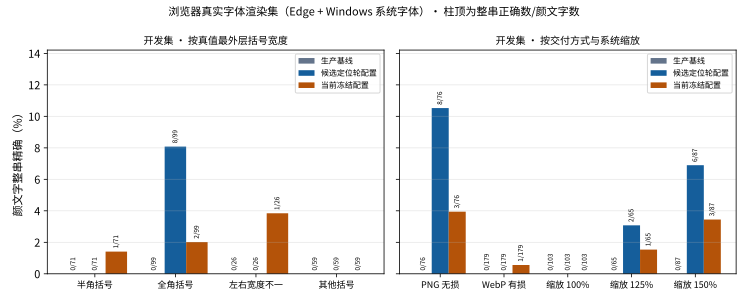

# 2026-10-15 浏览器真实字体渲染评测集：测量当前版本

[返回 README 评测结果](../../../README.md#评测结果) · [历次版本对比](../../../README.md#历次版本对比)

本轮不训练、不改任何识别规则或冻结配置，GPU 账本上限为 0 秒，只新建一套评测数据并测量已有版本。起因是上一轮计划的独立真实验证（用户用输入法逐条键入 known-input-2）不可行：其中的颜文字含大量输入法无法直接打出的字符，而且真实用户既会键入也会从网页粘贴，半角全角都会出现。输入方式本身不改变像素，决定识别结果的是存储的字符和浏览器用系统字体画出的字形；而此前所有合成数据都由 HarfBuzz/FreeType 与 OFL Noto 字体渲染，测不到真实字体。known-input-2 已作废（未录入、未评测、无首用凭据），作废记录与清单拒绝守卫见本轮证据。

**数据集 browser-cards-v1**（生成器 `localocr.browser-card-scenes.20261015.v1`，种子 20261015）：

- 用 Playwright 1.63.0 驱动本机 Edge 155，渲染仿制的记录卡片页面（深蓝/绿/红渐变圆角卡片、白色微软雅黑、副本名粗体，版式按已降级为开发探针的真实截图测得；徽记与图标为中性占位形状）。页面只用本地内容，非本地请求一律拦截且计数为 0；系统字体不复制，只记录实际使用的字族与文件 SHA256。浏览器为缺字回退到 Cambria Math、Segoe UI Symbol、Nirmala UI、Malgun Gothic、Tahoma、Times New Roman、Lucida Sans Unicode 等系统字体，这是训练渲染从未覆盖的情况。
- 评论文字取自原创 CC0 常见表达清单（另补 43 条原创粘贴式写法）与原子表组合，最外层括号按半角 45%、全角 45%、左右不一致 10% 抽样，不规定任何输入方式。系统缩放 100%/125%/150%、字号 16–20 px 按场景抽取，约一半场景先压成 webp（质量 70–95）再转回 PNG，模拟聊天上传。
- 评论在页面中保持单一文本节点（与真实网页一致）；真值掩码由背景截图加逐区域截图得到，评论段用 Custom Highlight API 着色取掩码，区间边界裁掉的越界抗锯齿像素归 3 像素内的评论段（颜文字优先）；只有另有评论段可及时才计为颜文字的接触像素（`contact_pixels`）。分段 `span` 渲染会在边界重排字形，探针中一半场景整体错位，因此不作为交付渲染。
- 独立代码复核发现首版把颜文字自身的越界像素也计为接触、越界归属距离可能沿扫描顺序外扩；修正后以同一种子重新生成，图片、文本与开发集掩码与首版逐字节相同，只有接触计数变化（开发集“粘连”颜文字 15→3、保留集 18→8），开发评测重跑后除接触分项外逐项相同。首版数据集移入忽略目录 `superseded/`，其保留集从未被读取。
- 开发集 60 张 / 255 面（半角 71、全角 99、混合 26、其他括号 59）/ 12 张负样本；保留集 120 张 / 481 面 / 24 张负样本，已封存。生成 2419 秒，0 张排除。

新代码先经等价性探针：上一轮已记录的 548 个场景与截图，用当前冻结配置与缺省键配置重放候选、路由与融合，区域与决策 0 不一致（复核修正后重跑仍为 0）；上一轮开发报告重新汇总逐项相同。

**开发集结果**（颜文字整串精确，逐字节，不做宽度归一化）：

| 对象 | 整串正确 / 255 | 仅外括号宽度不符 | CER | 安全完整覆盖 | 实际路由 | 正文新增错误 / 负样本新增非空 | 研究门禁 | 单张 p50 |
| --- | ---: | ---: | ---: | ---: | ---: | ---: | --- | ---: |
| 生产基线 | 0 | — | 94.85% | — | — | — | — | — |
| 候选定位轮配置（缺省键） | 8 | 5 | 90.48% | 78 | 119 | 3 / 0 | 未过 | 3.16 s |
| 当前冻结配置（真实渲染轮） | 4 | 9 | 90.59% | 80 | 136 | 3 / 0 | 未过 | 3.19 s |

“正文新增错误”为 2 处正文相交改写加 1 处正文字面被删，两个配置相同；典型例子是行尾残片 `、` 被相邻颜文字的替换吸收并读成 `ヽ`，与上两轮记录卡片保留集未过门禁的原因一致。

**分项**（当前冻结配置；括号内为候选定位轮配置）：

| 分项 | 颜文字数 | 整串正确 |
| --- | ---: | ---: |
| 半角括号 | 71 | 1（0） |
| 全角括号 | 99 | 2（8），另 7 处仅宽度不符 |
| 左右宽度不一 | 26 | 1（0） |
| 其他括号 | 59 | 0（0） |
| PNG 无损交付 | 76 | 3（8） |
| WebP 有损交付 | 179 | 1（0） |
| 系统缩放 100% | 103 | 0（0） |
| 系统缩放 125% / 150% | 65 / 87 | 1 / 3（2 / 6） |
| 与相邻评论段粘连 | 3 | 0（0） |

要点：

- **真实字体下的整体表现很低。** 开发集最好也只有 8/255（3.1%），远低于同一版本在合成卡片开发集上的表现，也低于已知输入真实截图探针的 16/50；后者是逐面诊断过、以常见表达为主的非独立集合，两者不能互相替代。
- **宽度裁决在全角输入上的代价被证实。** 当前配置把全角真值的外括号改成基线读出的半角，全角整串由 8 降到 2，另有 7 处只差宽度；半角与混合宽度各多对 1 处。用户的真实输入两种宽度都有，宽度应由模型从像素读出，而不是统一取基线。
- **损失主要在识别之前。** 当前配置下 255 面中 111 面的完整候选不具路由资格（像素括号形状未确认 62、邻近正文 16、裁片贴边 13），64 面只有切掉手臂的部分候选，11 面没有候选；送到专项后 46 面被拒，其中视图不一致 23。原子表组合的颜文字几乎全部失败（1/160），常见与粘贴式表达好一些（3/95）。
- **WebP 与 100% 缩放几乎全军覆没。** 有损压缩后 179 面只对 1 面；100% 缩放下两个配置都是 0/103，对的都在 125%/150%。这说明当前候选规则与专项在小字号、压缩噪声下基本不可用，而这正是聊天上传截图的常见条件。
- 负样本场景与图形区域没有新增输出；CPU 单张 p50 约 3.2 秒。

**保留集未首测。** 设计中原计划冻结后对保留集首测一次，但既有守卫在开发研究门禁未通过时拒绝双冻结（“新保留集保持未消耗”），两个配置在本数据上都因正文新增错误未过门禁。本轮没有削弱该守卫：选择冻结已写入（`scene-selection-browser-cards-002`），保留集 120 张保持封存、未读取、未消耗，按用户 2026-10-16 的决定留给下一轮改进后的首测，不为纯测量增加例外。本轮结论为“开发集测量完成、保留集未首测”。

结论口径：本集合是“浏览器真实字体渲染集”，不是真实截图准确率；真实截图今后只来自日常使用并以复制的评论文字为真值。候选模型继续 `promote=false`、`enabled=false`。匿名汇总、绑定 SHA 与图表见 [本轮汇总](summary.json)、[图表](figures/) 与 [可运行绘图源码](build_charts.py)；页面、截图、掩码与逐图预测位于忽略目录 `artifacts/browser-rendering-20261015/`。
