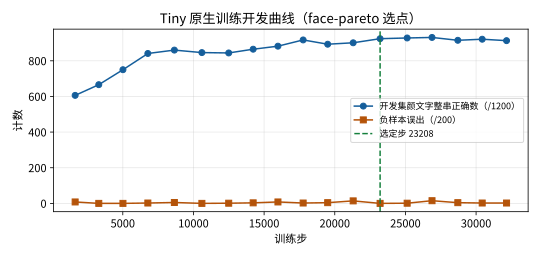
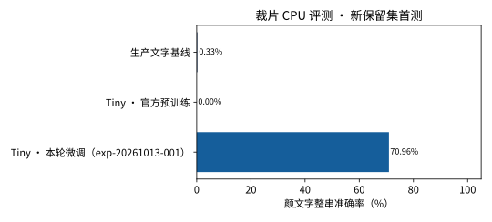
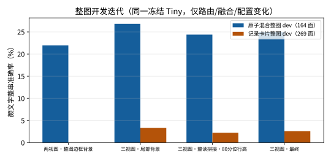
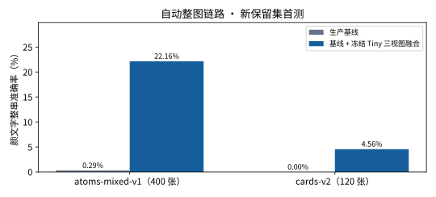

# 2026-10-13 颜文字语法、路由与融合研究：新保留集首测与真实截图探针

[返回 README 评测结果](../../../README.md#评测结果) · [历次版本对比](../../../README.md#历次版本对比)

本轮以单一 JSON 原子表驱动颜文字语法、语料、整图、路由与融合，新数据按完整标签、核心组合（眼、口、眼与括号对）与像素在训练、开发、保留之间互斥，并加入阴影、描边、背景纹理等渲染效果：裁片 16,000/2,000/4,000 张，原子混合整图 200/400 张；另按用户提供的真实记录列表截图版式新增原创"记录卡片"整图 60/120 张（原创徽记与图标、原创词组、评论内贴合/空格/独立/换行颜文字、每五张一张无颜文字负样本场景）。研究链路新增识别前首遍框切分、像素几何路由、合成训练的裁片三分类器、局部背景前景估计、三视图一致融合与整读拼接；上一轮已查看的保留资料登记为开发回归，不参与本轮独立结论。

Tiny 真实训练一次（face-pareto 选点）：选定 step 23208，原生开发集颜文字整串 924/1200（起点 2/1200），负样本误出 0/200；普通文字整串 141/400（起点 381/400），因此专项模型只作用于被路由的候选区域，普通正文仍由生产基线读取。ONNX 导出与原生前向 CPU 对照 23 例，最大绝对误差约 1e-7。

裁片首测基于新保留集中的 **2,400 张颜文字图像**（原始识别字符串，不作任何归一化）：

| 模型阶段 | 整串正确 | 整串准确率 | CER | P/S CER |
| --- | ---: | ---: | ---: | ---: |
| 生产文字基线 | 8/2400 | 0.33% | 68.16% | 66.64% |
| Tiny 官方预训练 | 0/2400 | 0.00% | 76.27% | 74.99% |
| Tiny 专项微调，开发选定 | **1703/2400** | **70.96%** | **4.74%** | **4.58%** |

同一保留集上普通文字整串为 770/800（生产 781/800），空白与图形负样本误出 0（生产 125）。本轮保留裁片比上一轮难（组合隔离、渲染效果），因此 70.96% 不与上一轮 95.33% 拼接比较。

自动整图首测在两套整图上分别进行，推理只接收原图与六字段输入清单：

| 自动整图链路（冻结 Tiny，三视图） | 颜文字整串正确 | 整串准确率 | CER | 正文/负样本新增错误 |
| --- | ---: | ---: | ---: | ---: |
| 原子混合整图 400 张（343 面，28 张负样本图）· 生产基线 | 1/343 | 0.29% | — | — |
| 原子混合整图 · 基线 + 专项融合 | **76/343** | **22.16%** | **62.69%** | 0 |
| 记录卡片整图 120 张（548 面，24 张负样本图）· 生产基线 | 0/548 | 0.00% | 95.29% | — |
| 记录卡片整图 · 基线 + 专项融合 | **25/548** | **4.56%** | **84.81%** | 0 |

两套整图的正文正确转错、错误改写、边界新增错误、文本删除以及负样本图与图形区域新增非空输出均为零，研究门禁通过。记录卡片版式在开发中暴露的结构缺口（深色卡片白字候选为零、同行图标并行、贴合颜文字整读被拒、复读二次作用、正文子框被拆散）已修正，但该版式的识别准确率仍然很低：主要损失来自专项多视图读法不一致、相邻字形粘连导致括号形状未检出，以及贴合正文的颜文字仍被当作混合文本拒绝。

真实截图探针：用户提供 4 张真实记录列表截图（88 行标签由像素转写，6 处颜文字码点无法唯一确定并标为 ambiguous）。冻结链路在 75 行无歧义正文上零丢失（基线与链路均完整包含 65 行），0 次路由替换，每张 p50 7.6 秒；因颜文字标签不可唯一确定，本轮不声明真实截图颜文字准确率。已知输入清单（50 行）已准备但未收到对应截图，真实颜文字验证记为阻塞：**合成通过、真实未验证**。候选 `ppocrv6-tiny-exp-20261013-001` 保持未启用，不替换生产文字基线。

本轮 GPU 实际使用 **3,252.876/7,200 秒**（含两次失败训练区间 784.7 与 45.0 秒），绑定上一轮账本 SHA；产物 1.12 GB / 2 GiB，磁盘余量 15.6 GB。匿名数值、绑定 SHA 与 6 张图见 [本轮汇总](summary.json) 与 [图表目录](figures/)；[可运行绘图源码](build_charts.py) 显式接收已完成的开发、首测与真实截图报告，不打开原图、标签、逐行预测、私人截图或权重。
