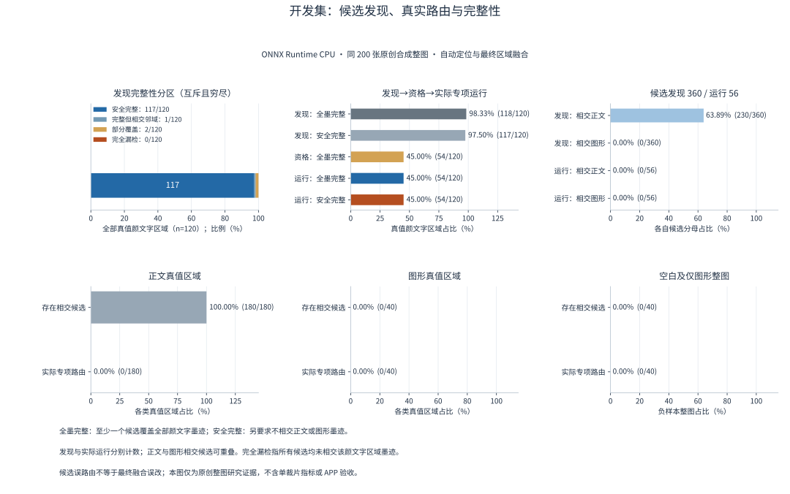
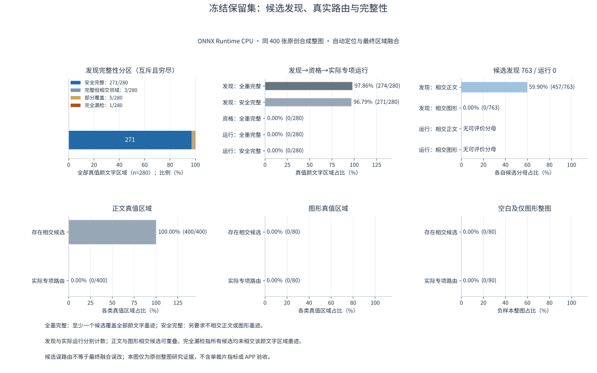
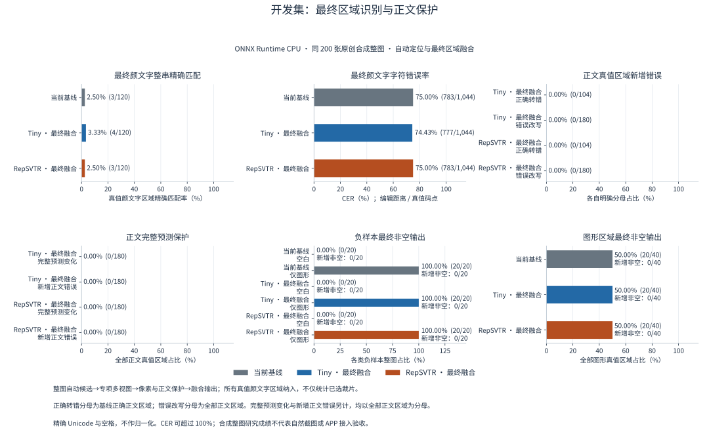
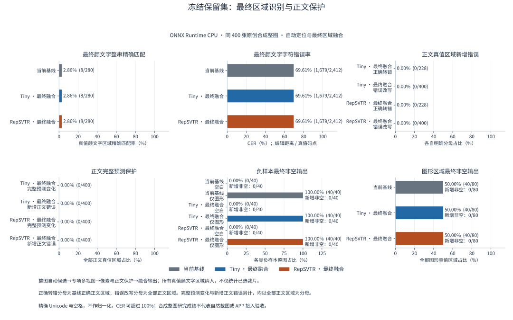

# 2026-10-12 自动定位、专项识别与融合

[返回 README 评测结果](../../../README.md#评测结果) · [历次版本对比](../../../README.md#历次版本对比)

独立链路保留通用文字基线，使用首遍文字/几何和原图像素发现候选。只有自动裁片的同模型两种实际像素视图原始字符串一致、额外结构和正文边界证据成立时才允许融合；不按跨模型原始分数替换。真值区域与墨迹掩码仅在推理结束后计量，不作为候选输入。整图字符串按已声明的几何阅读顺序拼接，基线与研究采用相同口径。

| 定位与路由指标 | 开发：200 张 / 120 个颜文字区域 | 新保留：400 张 / 280 个颜文字区域 |
| --- | ---: | ---: |
| 至少一个候选相交 | 120/120 | 279/280 |
| 覆盖全部实际墨迹 | 118/120 | 274/280 |
| 完整覆盖且不吞正文 | 117/120 | 271/280 |
| 实际送入专项的安全完整覆盖 | 54/120 | **0/280** |
| 实际送模型候选数 | 56 | **0** |
| 正文实际误路由 | 0/180 | 0/400 |
| 图形实际误路由 | 0/40 | 0/80 |

| 融合后的颜文字指标 | 开发整串 / 120 | 开发 CER | 新保留整串 / 280 | 新保留 CER |
| --- | ---: | ---: | ---: | ---: |
| 生产基线 | 3 | 75.00% | 8 | 69.61% |
| Tiny 区域链路 | 4 | 74.43% | 8 | 69.61% |
| RepSVTR 区域链路 | 3 | 75.00% | 8 | 69.61% |

开发集上 Tiny 有一次实际融合，颜文字整串由 3/120 增至 4/120；安全完整自动裁片的原始识别为 22/54，不能将其写成最终整图成功数。新保留集虽发现 279 个区域，冻结资格规则实际没有路由任何专项裁片，两模型都未执行保留集专项视图识别，最终逐项保留基线：整图匹配 93/400，颜文字匹配 8/280。该结果揭示资格规则的保留泛化失败，不证明专项识别有效。

两链路在开发集和保留集均无新增正文错误、文字删除或负样本非空输出；保留正文保持 228/400 正确。保留图形负样本仍有基线既有非空输出 40/40，空白为 0/40。零路由条件下的零误改不能作为有效增强链路通过门禁的依据。

400 张保留整图实际 CPU 耗时 347.72 秒；冷加载及首图 2.40 秒，预热后 p50/p95 为 750.82/1,501.36 ms，峰值 RSS/采样 Private 为 649.59/675.74 MiB，线程数 2/1。测量包括真实基线检测、方向、识别、候选处理及两个专项 session 加载；因实际专项视图数为零，不代表有路由负载时的完整识别成本。该评测未与其他模型推理并行，期间有文档生成活动，资源值不是隔离性能基准。

**区域链路判定：不具备接入资格。** 新保留集没有颜文字改善，规则与模型不因该结果重调；生产模型与 APP 保持原状态。坐标、父文本摘要、上下文复读、并排完整表达式保护与复现入口见[区域研究说明](../../../tools/RegionKaomoji/README.md)。
