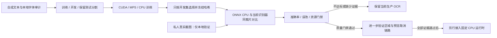

# 颜文字专项 OCR 开发工具

此目录用于合成训练与冻结候选测评。工具没有生产入口；仅凭手工裁片的识别结果不能自动接入应用。实际训练结果与接入判定见 [测评记录](RESULTS.md)。

## 数据与判定

- 合成文本、尺寸、缩放、模糊和背景由种子生成。可从用户指定的 [LDDGO 颜文字页](https://www.lddgo.net/common/emoticons) 的本地 HTML 提取文本，记录来源和哈希；HTML 与语料不随工具或应用发布，不将其标为开放许可数据集。训练、开发、测试的非空文本集合互不重叠。
- 测试使用保留主字体；缺字仍使用共享后备字体，不能宣称所有字形字体独立。
- 语料按精确文本去重，保留内部空格与原始码点；预留验证文本从训练、开发和测试的全部分割排除。扩充已有数据时保持原分割，新增语料单独按 70/10/20 分割。可为尚未训练的字符生成通用字形练习，禁止把测试整串变成训练文本。
- 字体 cmap 必须覆盖字符及组合簇；无法完整渲染的组合显式排除并计数。内部空格保留，首尾不可见空格不作标签。
- 清单、每张合成图和字符映射均绑定哈希。训练前冻结，结束后复核，测评再次核对。
- 原始 Unicode 码点和空格直接参与整串准确率、完整颜文字 CER 和符号 CER，均不做 NFKC、宽度或空格归一化。
- 同时记录整串正确变错误的回归，以及“候选不同于基线且不等于可靠标签”的新增错误改写；基线已错时改成另一种错误也会拒绝接入。
- 同一裁片对比当前固定识别器和候选的裸识别能力；这不代表应用自动定位或修正准确率。
- 私人原图、裁片、标签与逐项预测仅保存在本仓库忽略目录。模糊、截断或无法唯一确定码点的样本另列，不能补造精确标签。
- 保留合成测试和真实验证均需改善，无新增普通文字错误或负样本输出，并满足预设 CPU 预算。没有真实区域选择、额外像素证据及取消/预览链路证明时，判定始终拒绝接入。

## 流程

## 运行

以下命令在仓库根目录执行，输出目录必须是新的 artifacts 子目录。使用独立虚拟环境；不要修改应用固定 OCR 环境。

安装 GPU 训练端：按 [PyTorch 官方固定版本说明](https://pytorch.org/get-started/previous-versions/) 安装 torch 2.10.0；Windows NVIDIA 可用官方 CUDA 12.8 wheel。CPU 与 macOS 使用对应官方 wheel，再安装本目录 requirements-train.txt。所有训练依赖都不进入运行时包。

    python -m pip install -r tools/KaomojiOcr/requirements-train.txt
    python tools/KaomojiOcr/test_tools.py
    python tools/KaomojiOcr/audit.py --model <已核验的本地模型目录>/PP-OCRv6_rec_small.onnx --output artifacts/kaomoji/audit.json
    python tools/KaomojiOcr/corpus.py --html artifacts/kaomoji/source.html --output artifacts/kaomoji/corpus.json
    python tools/KaomojiOcr/synthetic.py --fonts <本地字体目录> --output artifacts/kaomoji/dataset --corpus artifacts/kaomoji/corpus.json --exclude-texts artifacts/kaomoji/reserved.json --glyph-drills
    python tools/KaomojiOcr/train.py --dataset artifacts/kaomoji/dataset --output artifacts/kaomoji/candidate --device auto
    python tools/KaomojiOcr/evaluate.py --dataset artifacts/kaomoji/dataset --candidate artifacts/kaomoji/candidate --baseline-models <已核验的本地模型绝对目录> --private-manifest artifacts/kaomoji/private.json --output artifacts/kaomoji/evaluation

reserved.json 使用 {"texts": ["<仅本地保留的原文>"]}，仅供排除和补充验证，不加入训练。首次生成不传 --base-dataset；扩充已有数据时添加 --base-dataset artifacts/kaomoji/previous-dataset，并换用新输出目录以保留旧文本分割归属。默认 --corpus-views 12 为新增训练语料生成 12 个变体，开发和测试使用单个变体。所有输出均需新路径，避免覆盖冻结资料。基线模型目录必须为绝对路径，且包含生产 worker 要求的完整固定模型与哈希。

字体目录需包含生成器声明的字体；字体本身不复制到仓库或数据集。默认字体清单为 Windows 字体，其他平台需提供合法可用的相应字体并重新建立独立测试分割。设备 auto 优先 CUDA，然后 MPS，再 CPU；MPS 的 CTC loss 使用 CPU 计算并回传梯度，ONNX 在 CPU 导出。macOS/MPS 尚未实机验收。

评估使用固定现有模型；worker 校验失败会终止，不下载缺失模型。资源测量使用独立子进程，包含候选冷加载、预处理和 48 次推理；资源探针用合成裁片放大到合计接近 100 万像素，单独记录实际像素预算，不影响准确率测评裁片。Windows 进程峰值 working set 用于内存门禁；其他平台未测得等价峰值时拒绝通过该门禁。

私人验证 JSON 格式（使用自有数据，以下均为占位）：

    {
      "usage": "independent-evaluation-only",
      "records": [
        {
          "source": "<本地原图绝对路径>",
          "rect": [0, 0, 100, 30],
          "kind": "face",
          "label": "<仅在可唯一确认时填写>",
          "ambiguous": true,
          "visible_features": ["<可确认的单个字形>"]
        }
      ]
    }

kind 支持 face、plain、blank、icon。负样本 label 为空。rect 使用原图实际像素坐标，不能按字符数估算。模糊样本不计精确指标；visible_features 只表示预测包含指定字符，不能证明重音、横线的数量或位置正确。

训练轮数可根据开发集收敛情况调整，并保留每次尝试记录；禁止用保留测试和私人截图结果选择参数。本次实际执行的候选参数和轮数以 training.json 为准。模型按开发集整串准确率选择，冻结后再测独立集。若依据真实结果调参，该批真实材料必须降为开发验证，并另找新的独立验证资料。工具会保留报告和候选，但不会修改 helper、依赖清单、数据库或发布包。

## 补充验证

预留原文与 emoji 的字库检查及字体合成测试可分别执行；所有标签和逐项预测仍在 artifacts 内，补充合成结果不能替代真实截图。

    python tools/KaomojiOcr/compatibility.py --dataset artifacts/kaomoji/dataset --baseline-model <固定模型绝对目录>/PP-OCRv6_rec_small.onnx --reserved-texts artifacts/kaomoji/reserved.json --output artifacts/kaomoji/compatibility.json
    python tools/KaomojiOcr/supplement.py --candidate artifacts/kaomoji/candidate --baseline-models <固定模型绝对目录> --reserved-texts artifacts/kaomoji/reserved.json --fonts <本地字体目录> --output artifacts/kaomoji/supplement

## Emoji 边界

颜文字专项字库不等于 emoji 序列字库。compatibility.py 可核对单个 emoji、变体选择符、旗帜或 ZWJ 组合的码点表达能力；报告只证明字库覆盖，不证明字体渲染、图像识别或实际导入正确。专项候选不能因为把 emoji 读成相似符号就获得接入资格。彩色 emoji 与组合序列的完整支持需独立验收。
